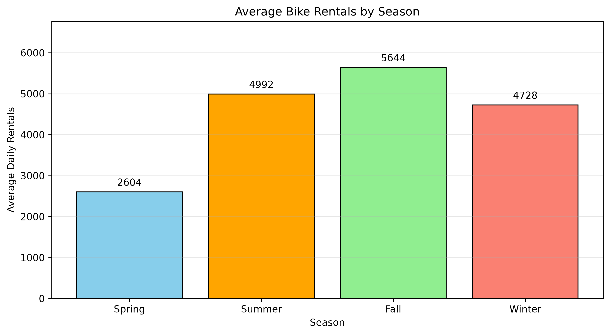
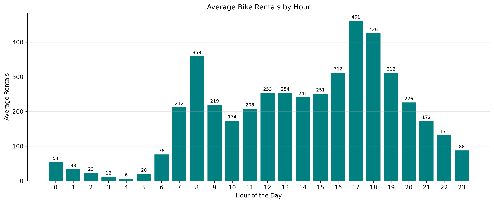
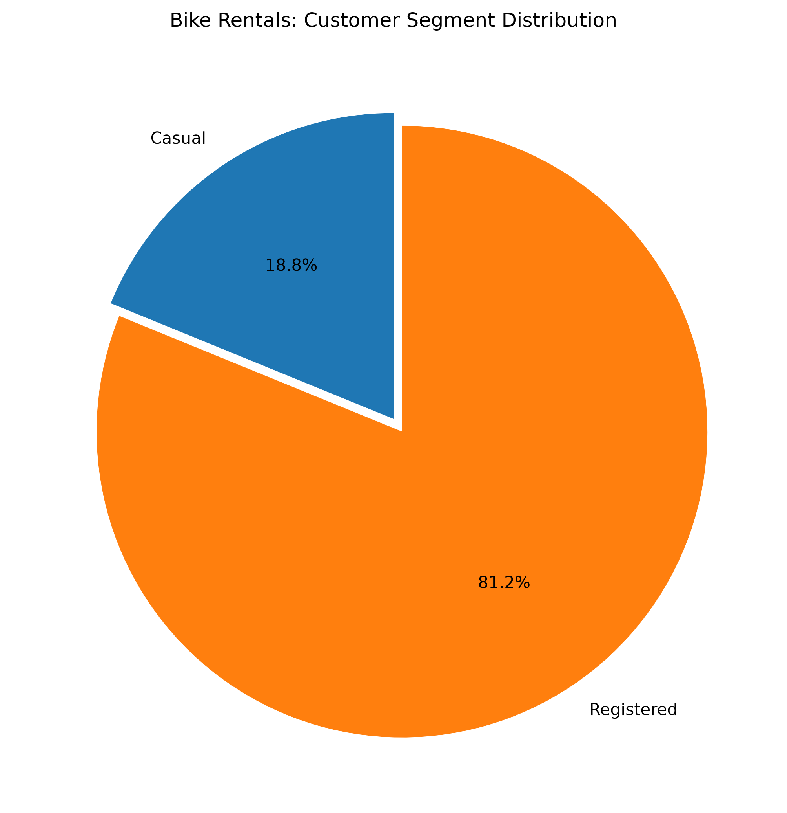
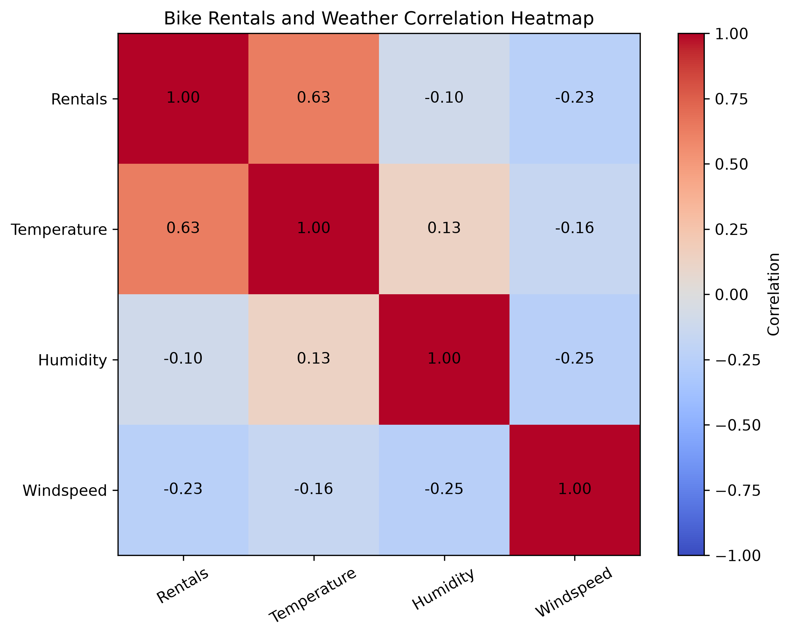

<h1 align="center">🚲 Bike Sharing Demand Analysis Using Python & NumPy</h1>

<p align="center"> <strong>Exploring Real-World Bike Rental Patterns Through Data Science</strong> </p>

<p align="center"> Python | NumPy | Matplotlib | Exploratory Data Analysis </p>

---

## 1. Project Overview

- This project presents an exploratory data analysis of the **UCI Bike Sharing Dataset (2011–2012)**.

- The objective is to understand how seasonal variations, weather conditions, working days, customer segments and hourly trends influence bike rental demand.

- Using Python, NumPy and Matplotlib, this project applies numerical computing, statistical analysis, data filtering, correlation analysis and visualization to transform raw rental data into meaningful business insights.

## 2. Problem Statement

- How can historical bike-sharing data be analyzed to identify rental demand patterns, understand customer behaviour and support better operational and business decisions?

## 3. Project Objectives

- Analyze daily and hourly bike rental demand. 
- Classify daily rental demand into different categories. 
- Identify seasonal rental patterns. 
- Examine the influence of weather conditions. 
- Compare working days and non-working days. 
- Understand casual and registered customer behaviour. 
- Analyze hourly rental demand. 
- Investigate correlations between numerical variables. 
- Identify the highest-demand rental days. 
- Develop data-driven business recommendations.

## 4. Technologies Used

| Technology | Application |
|---|---|
| Python | Programming and data processing |
| NumPy | Numerical computing and statistical analysis |
| Matplotlib | Data visualization |
| Jupyter Notebook | Interactive analysis |
| Git | Version control |
| GitHub | Project hosting |

## 5. Dataset Information

**Dataset:** UCI Bike Sharing Dataset

**Source:** [UCI Machine Learning Repository](https://archive.ics.uci.edu/dataset/275/bike+sharing+dataset)

| Attribute | Details |
|---|---:|
| Observation Period | 2011–2012 |
| Daily Records | 731 |
| Hourly Records | 17,379 |
| Total Daily Rentals | 3,292,679 |
| Dataset Files | day.csv and hour.csv |

The dataset contains historical bike rental information, including seasonal details, weather conditions, time, working-day indicators and customer rental counts.

## 6. Project Features

- Daily rental demand classification
- Seasonal demand analysis
- Weather condition analysis
- Working-day vs non-working-day comparison
- Casual vs registered customer analysis
- Hourly rental demand analysis
- Time-period demand comparison
- Temperature and windspeed statistical analysis
- Correlation matrix analysis
- Top five highest-demand days identification
- Business recommendations based on analytical findings

## 7. Key Findings

### Overall Demand

- Total daily rentals: **3,292,679** 
- High-demand days   : **286 (39.12%)** 
- Medium-demand days : **273 (37.35%)** 
- Low-demand days    : **172 (23.53%)**

### Seasonal Demand

- Fall recorded the highest average daily rentals : **5,644.30**. 
- Spring recorded the lowest average daily rentals: **2,604.13**.

### Customer Analysis

- Registered customers contributed **81.17%** of total rentals. 
- Casual customers contributed **18.83%** of total rentals.

### Hourly Demand

- Highest average hourly demand: **5 PM (461.45 rentals)**. 
- Lowest average hourly demand: **4 AM (6.35 rentals)**. 
- Evening recorded the highest total rentals: **1,322,969**.

### Weather and Correlation

- Temperature had the strongest positive correlation with rental demand among the analyzed weather variables: **0.627**. 
- Humidity showed a weak negative correlation: **-0.101**. 
- Windspeed showed a negative correlation: **-0.235**.

### Working-Day Analysis

- Working days recorded approximately **5.88% higher average rentals** than non-working days.

## 8. Data Visualizations

### 8.1 Seasonal Rental Demand



### 8.2 Hourly Rental Demand



### 8.3 Customer Segment Distribution



### 8.4 Correlation Heatmap



## 9. Business Recommendations

1. **Peak-Hour Planning:** Improve bike availability during high-demand hours, especially around 5 PM. 
2. **Seasonal Planning:** Prepare additional operational capacity during fall. 
3. **Customer Engagement:** Introduce targeted offers to increase casual customer participation. 
4. **Weather-Aware Operations:** Consider weather conditions when planning fleet availability. 
5. **Customer Retention:** Focus on maintaining the registered customer base through loyalty and engagement strategies.

## 10. Project Structure

```text
Bike_Sharing_Analysis/
│
├── data/
│   ├── day.csv
│   └── hour.csv
│
├── notebooks/
│   └── bike_sharing_numpy.ipynb
│
├── outputs/
│   ├── seasonal_demand.png
│   ├── hourly_demand.png
│   ├── customer_segments.png
│   ├── correlation_heatmap.png
│   └── analysis_results.txt
│
├── analysis.md
└── README.md
```

## 11. How to Run

### Step 1: Clone the Repository

```bash git clone https://github.com/aswinkumarv23451-cpu/data-science-practice.git ```

### Step 2: Install Required Libraries

```bash pip install numpy matplotlib notebook ```

### Step 3: Open the Project

Navigate to the `Bike_Sharing_Analysis` folder and open:

`notebooks/bike_sharing_numpy.ipynb`

### Step 4: Run the Notebook

Select the appropriate Python kernel and execute the notebook cells sequentially.

**Note:** The original dataset files (`day.csv` and `hour.csv`) must be placed inside the `data/` directory before running the notebook.

## 12. Future Improvements

- Perform advanced exploratory data analysis using Pandas. 
- Develop interactive analytical dashboards. 
- Build bike rental demand prediction models using Scikit-learn. 
- Apply machine learning algorithms for demand forecasting. 
- Explore time-series analysis to identify long-term rental trends.

## 13. Conclusion

This project demonstrates the practical application of Python and NumPy in real-world data analytics.

By analyzing historical bike-sharing data, the project identifies meaningful patterns in seasonal demand, hourly rental activity, customer segments, working days and weather conditions.

The findings provide useful insights into customer behaviour and operational planning.

The project strengthened practical skills in numerical computing, statistical analysis, data visualization and data-driven problem-solving.

## 14. Detailed Analysis Report

For the complete analytical report, including statistical tables, detailed interpretations, correlation results and business findings, refer to:

📄 **[View Detailed Analysis Report](./analysis.md)**

---

<p align="center"> <em>Developed as part of my Data Science learning journey.</em><br> <em>Turning data into meaningful insights.</em> </p>

<p align="center"> <strong>Author: ASWIN KUMAR V</strong><br> B.Tech – Artificial Intelligence and Data Science<br> <a href="https://github.com/aswinkumarv23451-cpu">GitHub Profile</a> </p> 
