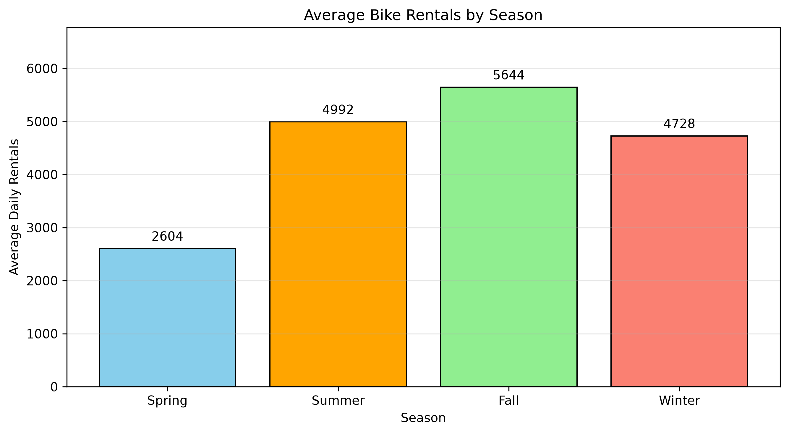
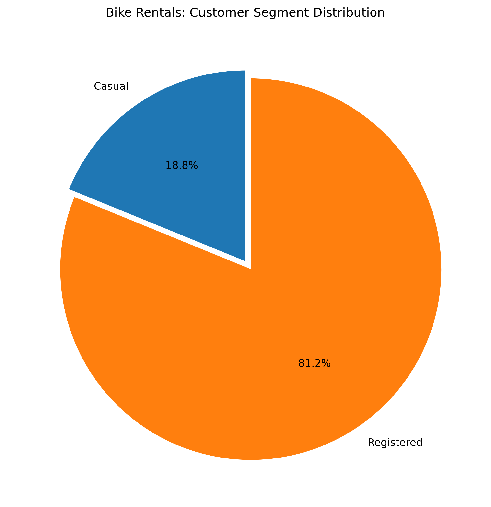
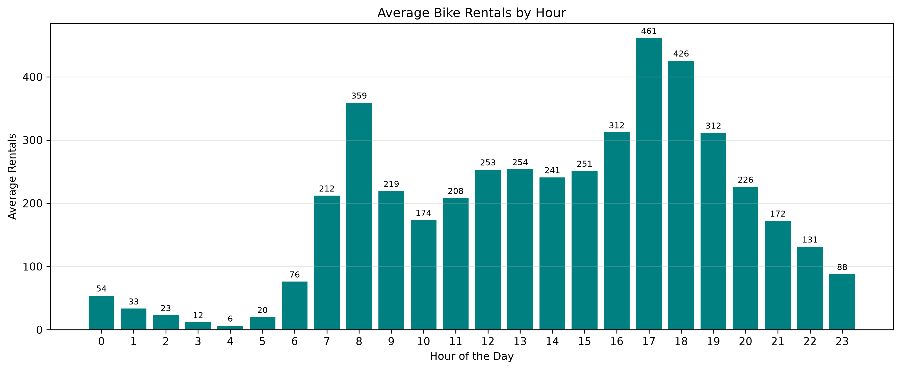
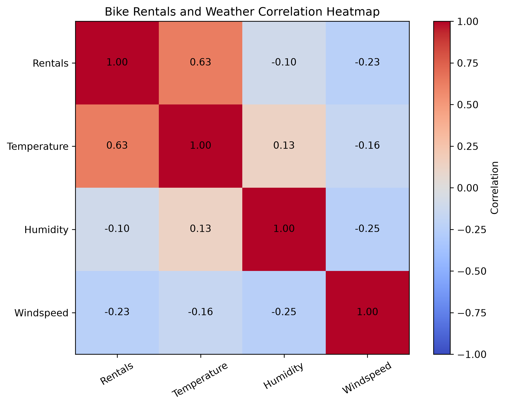

<h1 align="center">🚲 BIKE SHARING DEMAND ANALYSIS</h1>

  <strong>Business Analysis Report</strong>

  Python | NumPy | Matplotlib

  UCI Bike Sharing Dataset | 2011–2012

---

## 1. Project Overview

This project analyzes real-world bike-sharing data to understand rental demand patterns, customer behaviour, seasonal variations, hourly trends and relationships between weather conditions and rental activity.

The analysis was performed using Python and NumPy, with Matplotlib used to create visual representations of the findings.

The objective is to transform historical rental data into meaningful statistical insights and practical business recommendations.

## 2. Dataset Information

The analysis uses the UCI Bike Sharing Dataset, containing daily and hourly rental records collected during 2011 and 2012.

| Dataset Attribute | Value |
|---|---:|
| Daily Records | 731 |
| Hourly Records | 17,379 |
| Observation Period | 2011–2012 |
| Total Rentals | 3,292,679 |

**Dataset Source:** [UCI Machine Learning Repository – Bike Sharing Dataset](https://archive.ics.uci.edu/dataset/275/bike+sharing+dataset)

## 3. Daily Rental Demand Analysis

Daily rental demand was classified into three categories using custom thresholds.

| Demand Category | Number of Days | Percentage |
|---|---:|---:|
| Low (< 3,000) | 172 | 23.53% |
| Medium (3,000–5,000) | 273 | 37.35% |
| High (> 5,000) | 286 | 39.12% |

### Key Insight

High-demand days represented the largest category in the dataset, accounting for 39.12% of all recorded days.

This indicates that a considerable proportion of the observation period experienced relatively high bike rental activity.

## 4. Seasonal Demand Analysis

Average daily rentals were calculated for each season.

| Season | Average Daily Rentals |
|---|---:|
| Spring | 2,604.13 |
| Summer | 4,992.33 |
| Fall | 5,644.30 |
| Winter | 4,728.16 |

### Seasonal Rental Demand Visualization

### Key Insights

- Fall recorded the highest average daily rental demand.
- Spring recorded the lowest average daily rental demand.
- Rental activity varied considerably across seasons.

**Business Interpretation:** Seasonal demand patterns can help operators plan fleet availability and allocate operational resources more effectively.

## 5. Weather Analysis

Average daily rental demand was examined across different weather condition codes.

| Weather Condition Code | Number of Days | Average Rentals |
|---|---:|---:|
| 1 | 463 | 4,876.79 |
| 2 | 247 | 4,035.86 |
| 3 | 21 | 1,803.29 |
| 4 | 0 | No records |

### Key Insight

Average rental demand was lower under more adverse recorded weather conditions.

The results indicate that weather conditions are associated with changes in bike rental activity.

**Business Interpretation:** Weather information can be considered when planning fleet availability and operational capacity.

## 6. Working Day Analysis

Rental activity was compared between working days and non-working days.

| Measure | Non-working Days | Working Days |
|---|---:|---:|
| Number of Days | 231 | 500 |
| Total Rentals | 1,000,269 | 2,292,410 |
| Average Rentals | 4,330.17 | 4,584.82 |
| Median Rentals | 4,459 | 4,582 |
| Maximum Rentals | 8,714 | 8,362 |

### Key Insight

Working days recorded approximately 5.88% higher average rentals than non-working days.

This suggests that routine transportation activities may contribute to bike rental demand during working days.

## 7. Customer Segment Analysis

Bike-sharing customers were divided into two categories:

- Casual customers
- Registered customers

| Measure | Casual Customers | Registered Customers |
|---|---:|---:|
| Total Rentals | 620,017 | 2,672,662 |
| Average Daily Rentals | 848.18 | 3,656.17 |
| Maximum Daily Rentals | 3,410 | 6,946 |
| Share of Total Rentals | 18.83% | 81.17% |

### Customer Segment Visualization

### Key Insights

- Registered customers accounted for 81.17% of total rentals.
- Casual customers contributed 18.83%.
- Registered customers generated the majority of rental activity.

**Business Interpretation:** Registered customers form the largest customer segment. Customer retention and loyalty strategies are important for maintaining this user base.

## 8. Hourly Demand Analysis

Hourly rental records were analyzed to identify changes in demand throughout the day.

### Dataset Summary

| Attribute | Value |
|---|---:|
| Total Hourly Records | 17,379 |
| Unique Hours | 24 |
| Total Rentals | 3,292,679 |
| Highest Average Demand | 5 PM (461.45 rentals) |
| Lowest Average Demand | 4 AM (6.35 rentals) |

### Hourly Rental Demand Visualization

### Time Period Comparison

| Time Period | Average Rentals | Total Rentals |
|---|---:|---:|
| Early Morning (0–5) | 24.91 | 106,509 |
| Morning (6–11) | 208.10 | 907,319 |
| Afternoon (12–16) | 262.24 | 955,882 |
| Evening (17–23) | 259.51 | 1,322,969 |

### Key Insights

- 5 PM recorded the highest average hourly demand.
- 4 AM recorded the lowest average hourly demand.
- Afternoon recorded the highest average hourly demand among the four time periods.
- Evening recorded the highest total rentals.

**Business Interpretation:** Bike availability should be managed carefully during afternoon and evening periods to accommodate higher rental activity.

## 9. Temperature Analysis

Temperature values in the dataset are normalized.

### Statistical Summary

| Statistical Measure | Value |
|---|---:|
| Minimum | 0.0591304 |
| Maximum | 0.861667 |
| Mean | 0.4538479 |
| Median | 0.498333 |

### Key Insight

Temperature values were further examined using four approximately equal-sized groups based on sorted observations.

This grouping approach helps explore how rental activity varies across different temperature ranges.

**Note:** Temperature values are normalized and do not represent direct Celsius measurements.

## 10. Windspeed Analysis

Windspeed values in the dataset are normalized.

### Statistical Summary

| Statistical Measure | Value |
|---|---:|
| Minimum | 0.0223917 |
| Maximum | 0.507463 |
| Mean | 0.1904862 |
| Median | 0.180975 |
| Standard Deviation | 0.0774448 |

### Key Insight

The statistical results summarize windspeed variation across the dataset.

Windspeed was also examined through correlation analysis to understand its relationship with total rental demand.

**Note:** Windspeed values are normalized rather than expressed directly in km/h or m/s.

## 11. Correlation Analysis

Correlation analysis was performed to investigate relationships between weather variables, customer segments and total rental demand.

### 11.1 Weather Variables and Total Rentals

| Weather Variable | Correlation with Rentals |
|---|---:|
| Temperature | 0.627 |
| Humidity | -0.101 |
| Windspeed | -0.235 |

### Correlation Heatmap

### Key Insights

- Temperature showed the strongest positive linear correlation with rental demand among the three weather variables.
- Humidity showed a weak negative correlation.
- Windspeed showed a negative correlation with rental demand.

### 11.2 Customer Segments and Total Rentals

| Variable | Casual | Registered | Rentals |
|---|---:|---:|---:|
| Casual | 1.000 | 0.395 | 0.673 |
| Registered | 0.395 | 1.000 | 0.946 |
| Rentals | 0.673 | 0.946 | 1.000 |

### Key Insights

- Registered rentals showed a strong correlation with total rentals.
- Casual rentals showed a positive correlation with total rentals.
- The strong relationship between registered rentals and total rentals is expected because total rentals are the sum of casual and registered rentals.

**Note:** Correlation measures statistical association and does not establish causation.

## 12. Top Five Highest-Demand Days

The five days with the highest total rental demand were identified using numerical sorting and array indexing.

| Date | Total Rentals |
|---|---:|
| 2012-09-15 | 8,714 |
| 2012-09-29 | 8,555 |
| 2012-09-22 | 8,395 |
| 2012-03-23 | 8,362 |
| 2012-05-19 | 8,294 |

### Key Insight

September 15, 2012 recorded the highest rental demand, with 8,714 rentals.

Identifying peak-demand days helps reveal periods of exceptional rental activity.

## 13. Business Recommendations

Based on the analytical findings, the following recommendations can support better bike-sharing operations.

### 1. Peak-Hour Planning

Improve bike availability during high-demand hours, especially around 5 PM.

### 2. Seasonal Planning

Prepare additional operational capacity during fall, which recorded the highest average daily rental demand.

### 3. Customer Engagement

Introduce targeted promotional offers to increase casual customer participation.

### 4. Weather-Aware Operations

Consider weather conditions when planning fleet availability and operational capacity.

### 5. Customer Retention

Focus on maintaining the registered customer base through loyalty programs and customer engagement strategies.

## 14. Conclusion

The analysis identified important patterns in bike-sharing demand across seasons, hours, customer segments, working days and weather conditions.

The results showed that fall recorded the highest average seasonal demand, registered customers contributed the majority of rentals, and 5 PM recorded the highest average hourly demand.

Temperature demonstrated the strongest positive correlation with rental demand among the three weather variables analyzed.

NumPy was used for numerical processing, statistical calculations, grouping, sorting, filtering and correlation analysis. Matplotlib was used to create visualizations that communicate the findings.

This project demonstrates the practical application of Python and NumPy to real-world data analysis and business insight generation.

---

  <strong>End of Report</strong>

  <em>Turning data into meaningful insights.</em>

  <strong>Author: ASWIN KUMAR V</strong> 
  B.Tech – Artificial Intelligence and Data Science 
  <a href="https://github.com/aswinkumarv23451-cpu">GitHub Profile</a>

