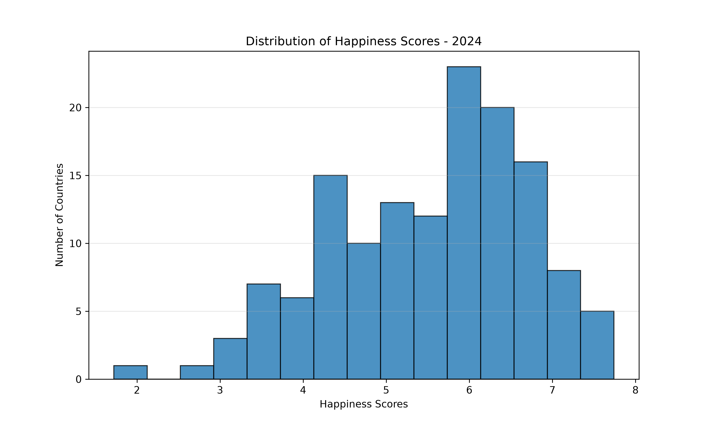
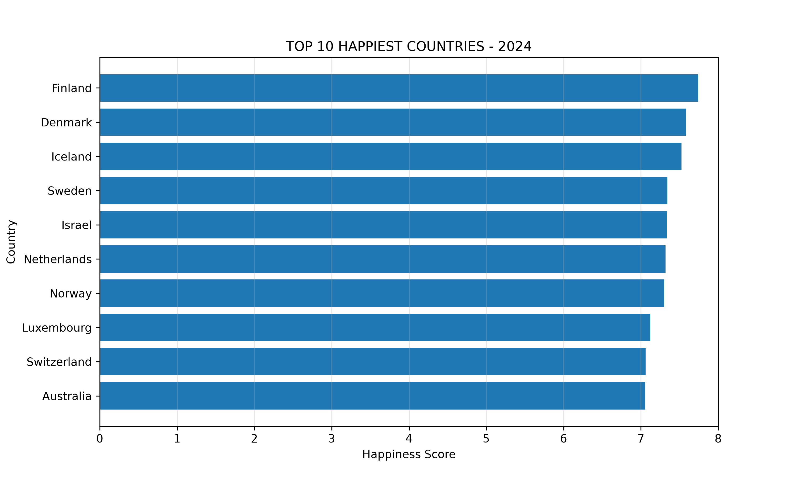
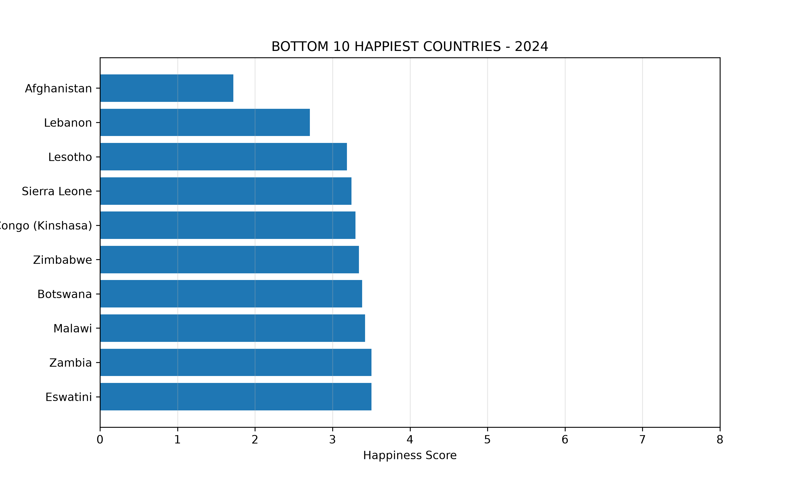
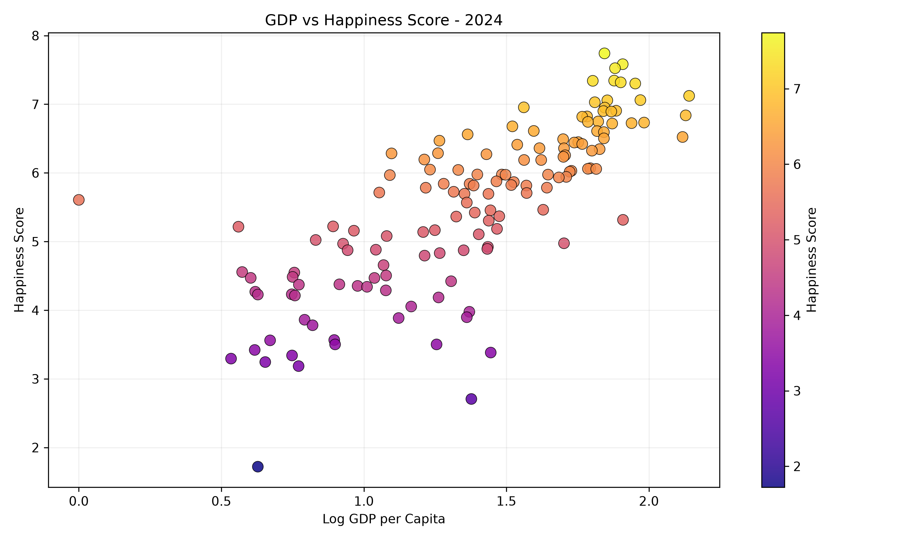
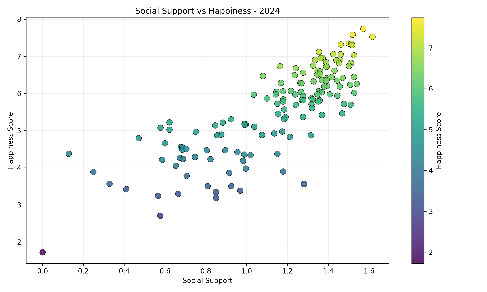
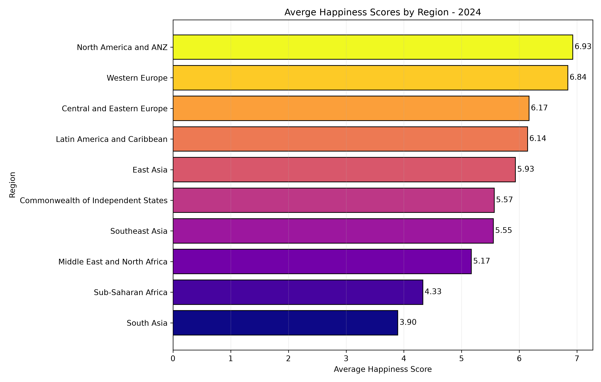
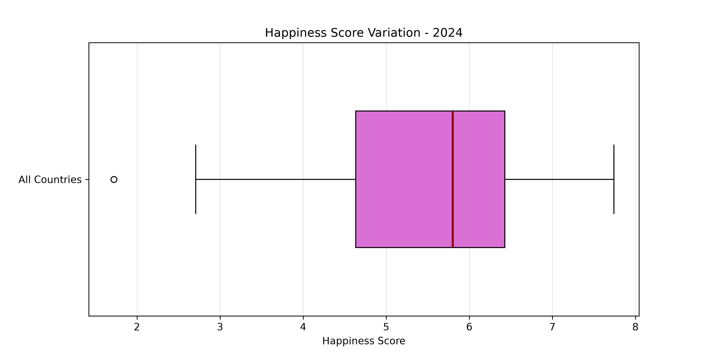
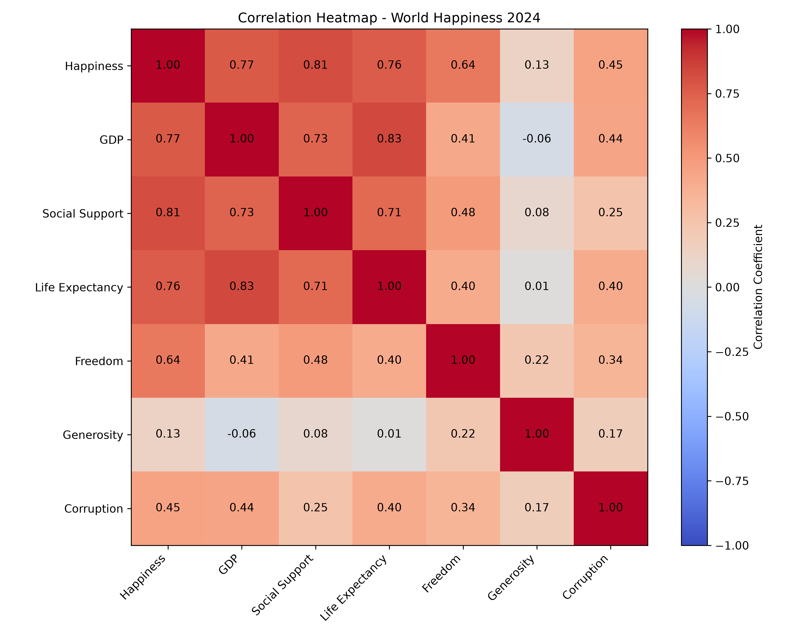
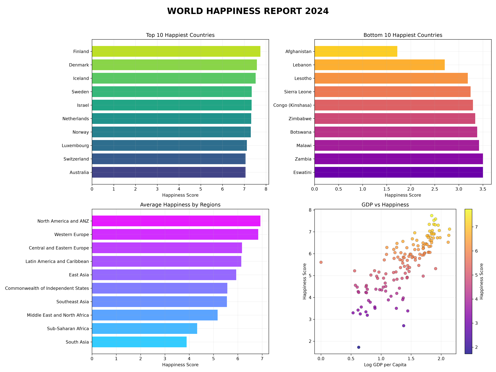

<h1 align="center">🌍 World Happiness & Quality of Life Analysis (2024)</h1>

  <strong>Exploring Global Happiness Through Data Science</strong>

---

## 1. Executive Summary

- This project presents an exploratory data analysis of the **World Happiness Report 2024** dataset.

- The objective is to investigate global happiness patterns, compare countries and geographical regions, and examine relationships between happiness and important quality-of-life indicators.

- Using Python, NumPy, and Matplotlib, this project applies statistical techniques and data visualization to transform raw data into meaningful insights.

### Project Highlights

- Analyzed 140 cleaned country records.
- Identified the happiest and least happy countries.
- Compared happiness across 10 geographical regions.
- Examined six important happiness-related indicators.
- Performed statistical and correlation analysis.
- Detected statistical outliers using the IQR method.
- Created nine professional visualizations.

---

## 2. Dataset Overview

| Attribute | Details |
|---|---|
| Dataset | World Happiness Report 2024 |
| Original Records | 143 |
| Clean Records | 140 |
| Incomplete Records Removed | 3 |
| Total Features | 12 |
| Data Format | CSV |

### Features Analyzed

1. Happiness Score
2. Log GDP per Capita
3. Social Support
4. Healthy Life Expectancy
5. Freedom to Make Life Choices
6. Generosity
7. Perceptions of Corruption

### Data Preprocessing

- Loaded the dataset using Python CSV processing.
- Examined the dataset structure and features.
- Identified incomplete records.
- Removed three incomplete records.
- Extracted numerical features into NumPy arrays.
- Prepared cleaned data for statistical analysis.

---

## 3. Descriptive Statistical Analysis

The following statistics summarize happiness scores across the 140 analyzed countries.

| Statistical Measure | Value |
|---|---:|
| Mean | 5.5308 |
| Median | 5.8000 |
| Standard Deviation | 1.1770 |
| Maximum | 7.741 |
| Minimum | 1.721 |
| Range | 6.020 |

### Interpretation

- The average happiness score is approximately 5.53.
- The median score is 5.80.
- The standard deviation indicates variation in happiness levels.
- The difference between the maximum and minimum scores highlights substantial variation across countries.

### Happiness Score Distribution

---

## 4. Top 10 Happiest Countries

The following countries recorded the highest happiness scores in the cleaned dataset.

| Rank | Country | Score |
|---:|---|---:|
| 1 | Finland | 7.741 |
| 2 | Denmark | 7.583 |
| 3 | Iceland | 7.525 |
| 4 | Sweden | 7.344 |
| 5 | Israel | 7.341 |
| 6 | Netherlands | 7.319 |
| 7 | Norway | 7.302 |
| 8 | Luxembourg | 7.122 |
| 9 | Switzerland | 7.060 |
| 10 | Australia | 7.057 |

**Key Insight:** Finland secured the first position with a happiness score of 7.741.

---

## 5. Bottom 10 Happiest Countries

The following countries recorded the lowest happiness scores.

| Rank | Country | Score |
|---:|---|---:|
| 1 | Afghanistan | 1.721 |
| 2 | Lebanon | 2.707 |
| 3 | Lesotho | 3.186 |
| 4 | Sierra Leone | 3.245 |
| 5 | Congo Kinshasa | 3.295 |
| 6 | Zimbabwe | 3.341 |
| 7 | Botswana | 3.383 |
| 8 | Malawi | 3.421 |
| 9 | Zambia | 3.502 |
| 10 | Eswatini | 3.502 |

**Key Insight:** Afghanistan recorded the lowest happiness score of 1.721.

---

## 6. GDP vs Happiness Analysis

This analysis investigates the relationship between Log GDP per Capita and happiness scores.

**Key Insight:** GDP per capita showed a strong positive correlation with happiness (0.769).

Countries with higher GDP per capita generally tend to report higher happiness scores in this dataset.

---

## 7. Social Support vs Happiness Analysis

Social support is examined to understand its relationship with national happiness.

**Key Insight:** Social support showed the strongest positive correlation with happiness among the analyzed factors, with a correlation coefficient of 0.814.

---

## 8. Regional Happiness Comparison

Average happiness scores were calculated for each geographical region.

| Region | Average Score |
|---|---:|
| North America and ANZ | 6.93 |
| Western Europe | 6.84 |
| Central and Eastern Europe | 6.17 |
| Latin America and Caribbean | 6.14 |
| East Asia | 5.93 |
| Commonwealth of Independent States | 5.57 |
| Southeast Asia | 5.55 |
| Middle East and North Africa | 5.17 |
| Sub-Saharan Africa | 4.33 |
| South Asia | 3.90 |

### Key Findings

- North America and ANZ recorded the highest regional average.
- Western Europe ranked second.
- South Asia recorded the lowest regional average.
- Considerable differences exist between regional averages.

---

## 9. Happiness Score Variation and Outlier Detection

The Interquartile Range (IQR) method was used to identify statistical outliers.

### Statistical Results

| Measure | Value |
|---|---:|
| First Quartile (Q1) | 4.632 |
| Median | 5.800 |
| Third Quartile (Q3) | 6.426 |
| Interquartile Range | 1.795 |
| Lower Bound | 1.940 |
| Upper Bound | 7.324 |
| Number of Outliers | 6 |

*Note: Quartiles and IQR are displayed in rounded form. Calculations use the underlying numerical values.*

### Identified Outliers

**High-Side Outliers:**
- Finland
- Denmark
- Iceland
- Sweden
- Israel

**Low-Side Outlier:**
- Afghanistan

**Interpretation:** Six countries fall outside the calculated IQR bounds, indicating unusually high or low happiness scores compared with the overall distribution.

---

## 10. Correlation Analysis

Correlation analysis was performed to examine the strength and direction of relationships between happiness and selected numerical features.

### Correlation with Happiness Score

| Feature | Correlation |
|---|---:|
| Social Support | 0.814 |
| Log GDP per Capita | 0.769 |
| Healthy Life Expectancy | 0.760 |
| Freedom | 0.644 |
| Perceptions of Corruption | 0.452 |
| Generosity | 0.130 |

### Correlation Heatmap

### Major Observations

1. Social support has the strongest positive correlation with happiness.
2. GDP per capita also shows a strong positive relationship.
3. Healthy life expectancy has a strong positive correlation.
4. Freedom shows a moderately strong positive relationship.
5. Perceptions of corruption showed a positive statistical correlation (0.452) in this dataset. This does not imply that corruption improves happiness.
6. Generosity has the weakest positive correlation among the analyzed features.

**Note:** Correlation indicates statistical association and does not establish causation.

---

## 11. Final Analytical Dashboard

The dashboard combines multiple visualizations into one consolidated analytical view.

The dashboard provides an overview of:

- Top 10 happiest countries.
- Bottom 10 happiest countries.
- Regional happiness averages.
- GDP and happiness relationship.

---

## 12. Overall Key Findings

The analysis produced the following major findings:

1. Finland recorded the highest happiness score of 7.741.
2. Afghanistan recorded the lowest happiness score of 1.721.
3. The overall mean happiness score was 5.5308.
4. North America and ANZ had the highest regional average.
5. South Asia had the lowest regional average.
6. Social support showed the strongest positive correlation with happiness.
7. GDP per capita and healthy life expectancy also showed strong positive correlations.
8. Six countries were identified as statistical outliers using the IQR method.

---

## 13. Conclusion

This project demonstrates how data science techniques can be applied to explore global happiness patterns and investigate factors associated with quality of life.

Through data cleaning, statistical analysis, correlation analysis, outlier detection, and visualization, meaningful patterns were identified across countries and geographical regions.

The findings highlight the importance of examining social, economic, and health-related indicators when studying national happiness.

The project also strengthened practical skills in Python, NumPy, Matplotlib, statistical interpretation, and analytical problem-solving.

---

## 14. Technologies and Tools

| Technology | Application |
|---|---|
| Python | Programming and analysis |
| NumPy | Numerical computing |
| Matplotlib | Data visualization |
| CSV | Dataset processing |
| Jupyter Notebook | Interactive analysis |

### Skills Demonstrated

- Data preprocessing and cleaning
- Numerical computing with NumPy
- Descriptive statistical analysis
- Correlation analysis
- Outlier detection using IQR
- Data visualization
- Analytical interpretation
- Dashboard development

---

## Project Information

**Project:** World Happiness & Quality of Life Analysis

**Year:** 2024

**Domain:** Data Science and Exploratory Data Analysis

---

  <strong>End of Report</strong>

  <em>Turning data into meaningful insights.</em>

  <strong>Author: ASWIN KUMAR V</strong> 
  B.Tech – Artificial Intelligence and Data Science 
  <a href="https://github.com/aswinkumarv23451-cpu">GitHub Profile</a>

