<h1 align="center">
  <strong>STUDENT ACADEMIC PERFORMANCE & LIFESTYLE ANALYSIS</strong>
</h1>

<p align="center">
  <strong>Detailed Exploratory Data Analysis Report</strong>
</p>

<p align="center">
  Python | Pandas | NumPy | Seaborn | Matplotlib
</p>

<p align="center">
  <strong>Author:</strong> ASWIN KUMAR V
  <br>
  B.Tech — Artificial Intelligence and Data Science
</p>

---

# 1. Project Overview

## 1.1 Introduction

- This project focuses on analysing student academic performance and exploring its relationship with study habits, lifestyle choices, family background, and personal characteristics.

- The analysis uses the Student Performance dataset from the UCI Machine Learning Repository, specifically the Mathematics dataset (`student-mat.csv`).

- Python-based data analysis and visualization techniques are used to identify patterns, compare groups, examine statistical relationships, and derive meaningful insights from the dataset.

- The primary academic performance variable is `G3`, representing the student's final mathematics grade.

## 1.2 Project Objectives

The main objectives are:

1. Understand the structure and characteristics of the dataset.
2. Examine academic performance and grade progression.
3. Investigate the relationship between study time and final grades.
4. Compare academic performance across genders.
5. Analyse the relationship between previous failures and final grades.
6. Explore parental education and student performance.
7. Investigate lifestyle factors such as alcohol consumption, free time, and social activities.
8. Examine the influence of internet access and health-related variables.
9. Perform statistical and correlation analysis.
10. Communicate findings through meaningful visualizations.

## 1.3 Project Scope

This project primarily focuses on Exploratory Data Analysis (EDA).

It does not attempt to establish causal relationships or build a predictive machine learning model.

The objective is to understand the available data, identify patterns, and develop data interpretation skills.

---

# 2. Project Structure

The project follows a modular organization that separates the dataset, analysis notebook, generated visualizations, and documentation.

**Project directory:** `Student_Performance_Analysis/`

<!-- INSERT COMPLETE PROJECT FILE STRUCTURE HERE -->

Refer to the project structure section in `README.md` for the complete directory tree and visualization filenames.

| Component | Purpose |
|---|---|
| `data/` | Stores the original dataset. |
| `notebooks/` | Contains the Jupyter Notebook used for analysis. |
| `outputs/` | Stores the generated visualization images. |
| `analysis.md` | Documents detailed analysis, findings, and interpretations. |
| `README.md` | Provides the project overview and visualization gallery. |

---

## 3. Dataset Overview

### 3.1 Dataset Information

| Attribute | Details |
|:---|:---|
| Dataset Name | Student Performance Dataset |
| Source | UCI Machine Learning Repository |
| File | `student-mat.csv` |
| Domain | Education and Student Performance |
| Total Records | 395 |
| Total Features | 33 |
| Target Variable | `G3` (Final Grade) |
| Grade Scale | 0–20 |
| Missing Values | 0 |
| Duplicate Records | 0 |

### 3.2 Dataset Description

The dataset contains academic, demographic, social and lifestyle information about students enrolled in mathematics courses.

It includes information about:

- Student demographics and family background.
- Previous academic performance.
- Study time and educational support.
- Absences and past academic failures.
- Social activities and free time.
- Weekday and weekend alcohol consumption.
- Health and internet access.
- First-period grade (`G1`), second-period grade (`G2`) and final grade (`G3`).

### 3.3 Important Features

| Feature | Description |
|:---|:---|
| `sex` | Student gender |
| `age` | Student age |
| `studytime` | Weekly study-time category |
| `failures` | Number of past class failures |
| `absences` | Number of school absences |
| `Dalc` | Workday alcohol consumption |
| `Walc` | Weekend alcohol consumption |
| `freetime` | Free time after school |
| `goout` | Frequency of going out with friends |
| `health` | Current health status |
| `internet` | Internet access at home |
| `Medu` | Mother's education level |
| `Fedu` | Father's education level |
| `G1` | First-period grade |
| `G2` | Second-period grade |
| `G3` | Final grade |

### 3.4 Target Variable

The primary target variable is `G3`, representing the student's final mathematics grade.

The analysis uses `G3` to examine how academic history, study habits, family background and lifestyle characteristics relate to final academic performance.

---

## 4. Tools, Technologies and Libraries

### 4.1 Python Libraries

The project uses Python and its data analysis and visualization ecosystem.

```python
import numpy as np
import pandas as pd
import seaborn as sns
import matplotlib.pyplot as plt
```

| Library | Purpose |
|:---|:---|
| Python | Main programming language |
| NumPy | Numerical operations |
| Pandas | Data manipulation and analysis |
| Seaborn | Statistical data visualization |
| Matplotlib | Plot creation and customization |
| Jupyter Notebook | Interactive analysis environment |

### 4.2 Visualization Techniques

The project uses several visualization techniques to identify patterns and relationships.

| Visualization | Analytical Purpose |
|:---|:---|
| Histogram | Understand grade distributions |
| Box Plot | Examine grade spread and outliers |
| Violin Plot | Compare grade distributions across groups |
| Bar Plot | Compare average academic performance |
| Count Plot | Examine categorical distributions |
| Scatter Plot | Explore relationships between variables |
| Heatmap | Visualize correlations and grouped values |
| Pair Plot | Explore relationships among multiple variables |
| Joint Plot | Examine relationships between two variables |
| FacetGrid | Compare multiple subgroups |
| Line Plot | Examine grade progression |

---

## 5. Data Loading, Processing and Cleaning

### 5.1 Loading the Dataset

The mathematics performance dataset was loaded using Pandas.

```python
df = pd.read_csv("data/student-mat.csv", sep=";")
```

The semicolon separator (`;`) was specified because the original dataset uses semicolon-delimited values.

### 5.2 Initial Data Inspection

The dataset was inspected to understand its structure, dimensions and data types.

```python
df.head()
df.tail()
df.shape
df.info()
df.describe()
```

**Dataset dimensions:**

| Measurement | Result |
|:---|---:|
| Rows | 395 |
| Columns | 33 |
| Total Records | 395 |
| Total Features | 33 |

### 5.3 Missing Value Analysis

Missing values were checked across all columns.

```python
df.isnull().sum()
```

**Result:** No missing values were identified in the dataset.

### 5.4 Duplicate Record Analysis

Duplicate records were checked to assess data consistency.

```python
df.duplicated().sum()
```

**Result:** No duplicate records were identified.

### 5.5 Data Type Verification

The data types of all columns were inspected to ensure that numerical and categorical variables could be analyzed appropriately.

```python
df.dtypes
```

### 5.6 Data Cleaning Summary

| Data Quality Check | Result |
|:---|:---|
| Total Records | 395 |
| Total Columns | 33 |
| Missing Values | 0 |
| Duplicate Records | 0 |
| Dataset Structure | Verified |
| Data Types | Inspected |

The dataset was structurally consistent and did not require missing-value imputation or duplicate removal.

### 5.7 Data Preparation

The original dataset was retained for analysis. Relevant numerical and categorical features were selected for statistical exploration and visualization.

The final grade (`G3`) was used as the primary academic performance variable throughout the project.

**Data preparation outcome:** The dataset was ready for exploratory data analysis and statistical visualization.

### 5.8 Final Dataset Verification

After data inspection and cleaning checks, the dataset was verified before beginning exploratory analysis.

```python
print("Dataset Shape:", df.shape)
print("Missing Values:", df.isnull().sum().sum())
print("Duplicate Records:", df.duplicated().sum())
print("Column Names:", df.columns.tolist())
```

The verification confirmed that the dataset contained 395 records and 33 columns, with no missing values or duplicate records.

---

## 6. Exploratory Data Analysis (EDA)

Exploratory Data Analysis was performed to understand the distribution of student grades and investigate relationships between academic performance, study habits, demographic characteristics and lifestyle factors.

The final mathematics grade (`G3`) was used as the primary variable for comparison.

### 6.1 Distribution of Final Grades

The distribution of final grades was examined to understand the overall academic performance of students.

**Visualization:** `outputs/grade_distribution.png`

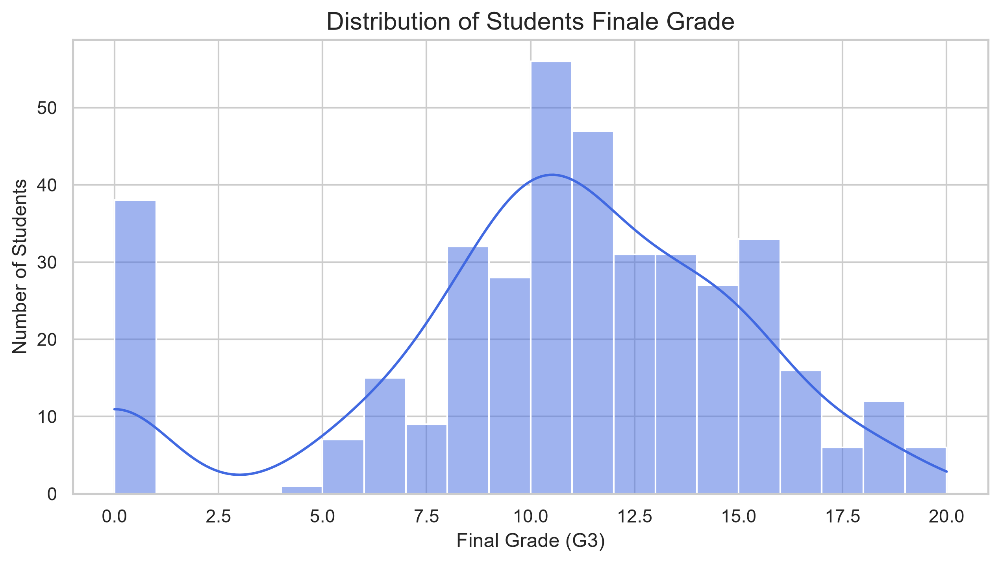

**Observations:**
- The average final grade was approximately 10.42 out of 20.
- The median final grade was 11.
- The minimum grade was 0, while the maximum was 20.
- The distribution shows variation in student academic performance.

### 6.2 Grade Progression Across Periods

The first-period (`G1`), second-period (`G2`) and final-period (`G3`) grades were compared.

**Visualization:** `outputs/grade_progression.png`

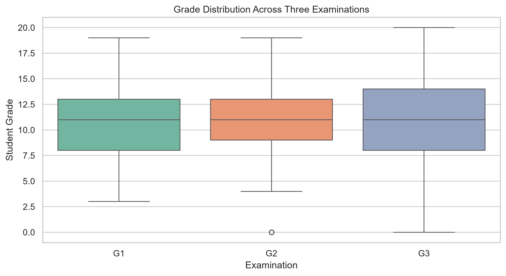

| Grade | Mean | Median |
|:---|---:|---:|
| G1 | 10.91 | 11 |
| G2 | 10.71 | 11 |
| G3 | 10.42 | 11 |

**Observations:**
- The mean grade decreased slightly across the three assessment periods.
- The median remained constant at 11.
- Previous academic performance provides useful context for understanding final grades.

### 6.3 Overall Grade Distribution Using a Box Plot

A box plot was used to examine the spread, median and potential outliers in final grades.

**Visualization:** `outputs/grade_boxplot.png`

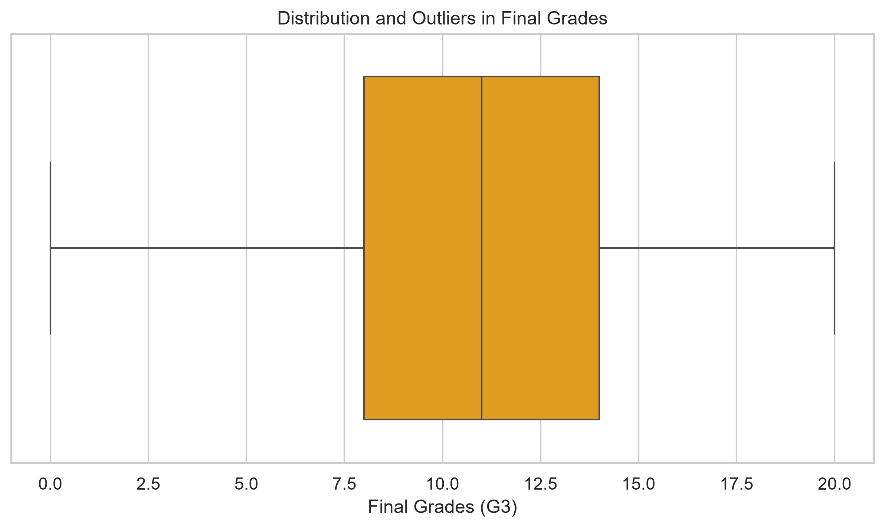

**Observations:**
- The median final grade was 11.
- Student grades varied considerably.
- The distribution includes students with very low and very high final grades.

### 6.4 Gender Distribution

The number and proportion of female and male students were examined.

**Visualization:** `outputs/gender_distribution.png`

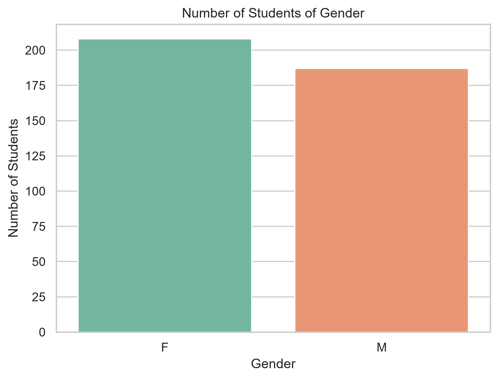

| Gender | Students | Percentage |
|:---|---:|---:|
| Female | 208 | 52.66% |
| Male | 187 | 47.34% |
| **Total** | **395** | **100%** |

**Observations:**
- Female students represented approximately 52.66% of the dataset.
- Male students represented approximately 47.34%.
- The dataset has a relatively balanced gender distribution.

### 6.5 Final Grades by Gender

The distribution of final grades was compared between female and male students.

**Visualization:** `outputs/grade_by_gender.png`

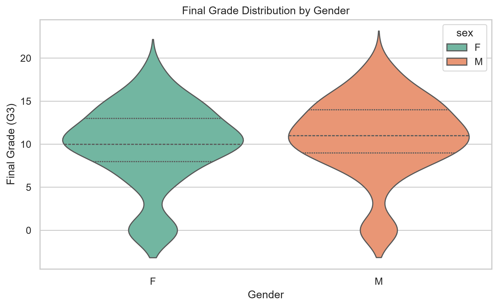

**Observations:**
- The visualization helps compare grade distributions between the two groups.
- Both groups show variation in academic performance.
- Gender alone should not be treated as an explanation for differences in individual student performance.

---

## 7. Study Time and Academic Performance

Study time was examined to understand its relationship with students' final mathematics grades.

The dataset uses four study-time categories:

| Category | Weekly Study Time |
|:---:|:---|
| 1 | Less than 2 hours |
| 2 | 2–5 hours |
| 3 | 5–10 hours |
| 4 | More than 10 hours |

### 7.1 Study Time Distribution and Final Grades

**Visualization:** `outputs/studytime_boxplot.png`

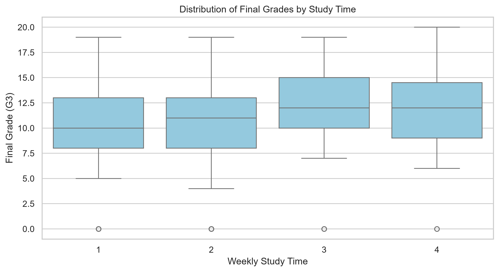

The distribution of final grades was compared across the four study-time categories.

### 7.2 Average Final Grade by Study Time

**Visualization:** `outputs/studytime_vs_grades.png`

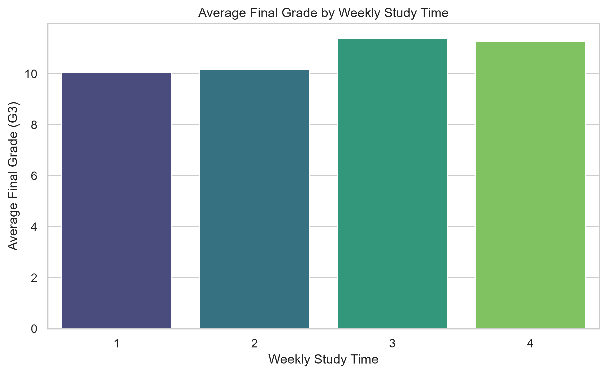

| Study Time | Students | Mean G3 | Median G3 |
|---:|---:|---:|---:|
| 1 | 105 | 10.05 | 10 |
| 2 | 198 | 10.17 | 11 |
| 3 | 65 | 11.40 | 12 |
| 4 | 27 | 11.26 | 12 |

**Observations:**
- Students in study-time category 3 recorded the highest average final grade.
- Category 4 also showed a higher average grade than categories 1 and 2.
- The relationship is not perfectly linear.
- The results suggest an association between study time and academic performance, but do not establish causation.

### 7.3 Study Time Distribution by Gender

**Visualization:** `outputs/studytime_by_gender.png`

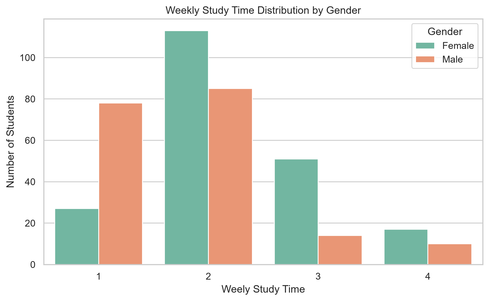

The number of female and male students in each study-time category was compared.

### 7.4 Study Time and Gender Percentage

**Visualization:** `outputs/studytime_gender_percentage.png`

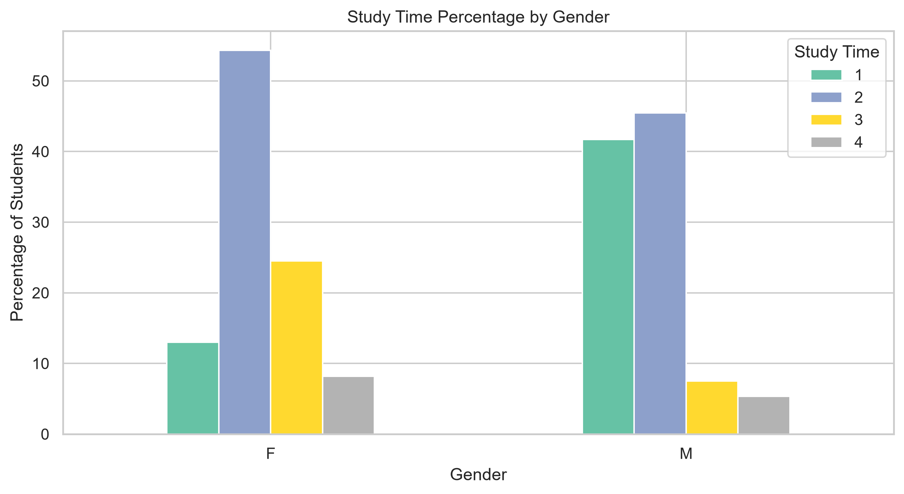

### 7.5 Study Time and Gender-Based Grade Comparison

**Visualization:** `outputs/studytime_gender_grades.png`

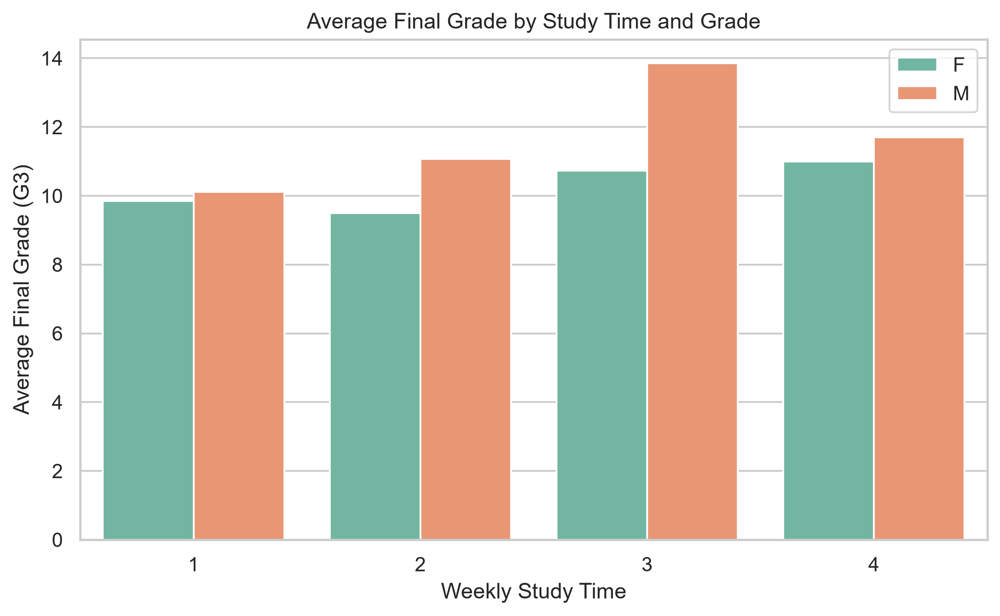

**Observations:**
- The distribution of students across study-time categories differs by gender.
- Average grades vary across the combined study-time and gender groups.
- Group sizes are unequal, so smaller groups should be interpreted cautiously.

### 7.6 Study Time and Gender Facet Analysis

**Visualization:** `outputs/studytime_gender_facetgrid.png`

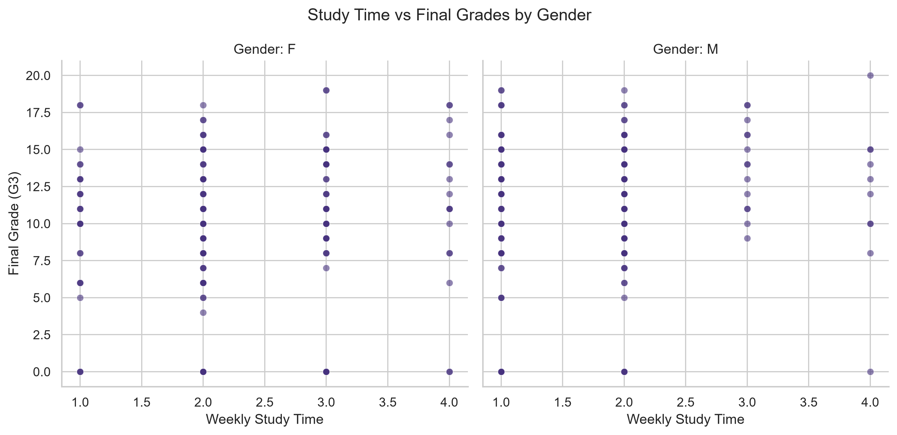

The FacetGrid visualization provides a separate view of grade distributions across study-time categories and gender groups.

### 7.7 Study Time and Grade Relationship Using Joint Plot

**Visualization:** `outputs/studytime_jointplot.png`

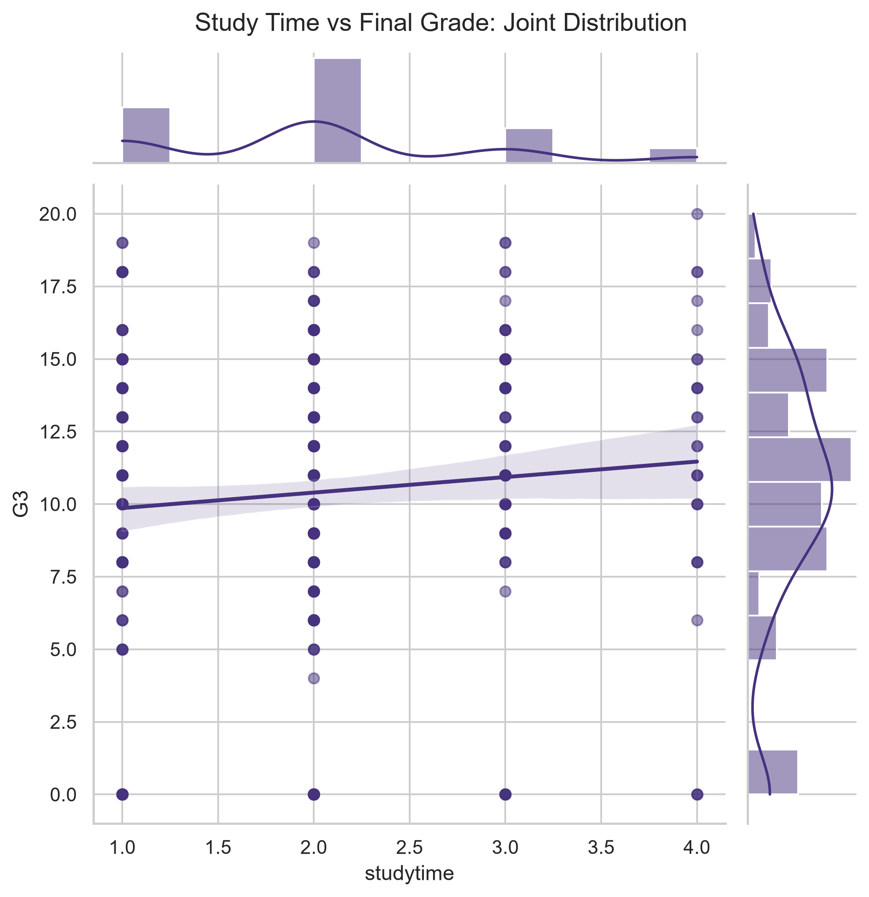

The joint plot provides an additional view of the relationship and distributions of the selected variables.

---

## 8. Past Failures and Academic Performance

The number of previous class failures was analyzed to investigate its relationship with final mathematics grades.

**Visualization:** `outputs/failures_vs_grades.png`

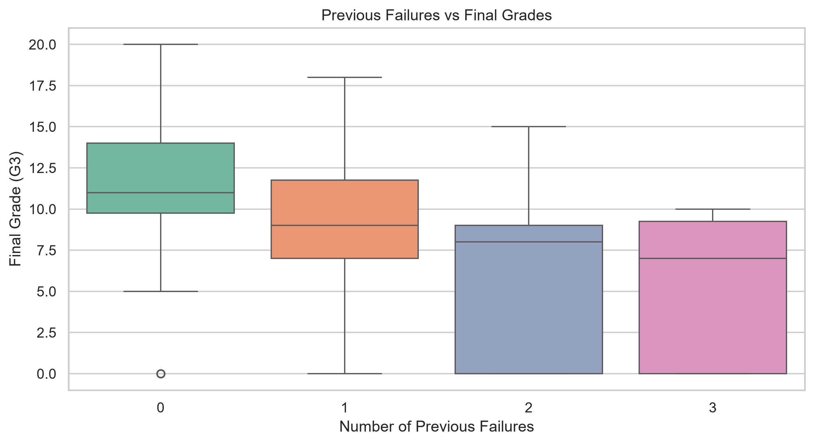

| Past Failures | Students | Mean G3 | Median G3 |
|---:|---:|---:|---:|
| 0 | 312 | 11.25 | 11 |
| 1 | 50 | 8.13 | 9 |
| 2 | 17 | 6.24 | 8 |
| 3 | 16 | 5.69 | 7 |

**Observations:**
- Students with no previous failures recorded the highest average final grade.
- Average grades generally decreased as the number of past failures increased.
- The relationship indicates a negative association between previous failures and final academic performance.
- Previous failures may be a useful indicator when identifying students who could benefit from additional academic support.

---

## 9. Absences and Academic Performance

The number of school absences was examined to understand its relationship with final grades.

**Visualization:** `outputs/absences_vs_grades.png`

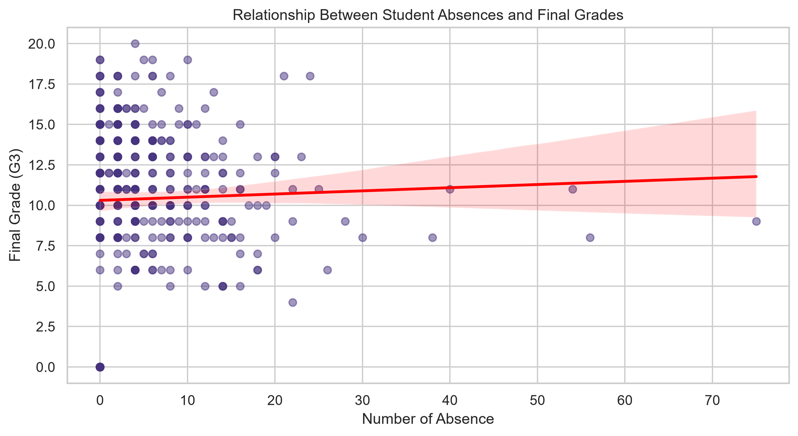

**Statistical Summary:**

| Statistic | Absences |
|:---|---:|
| Mean | 5.71 |
| Standard Deviation | 8.00 |
| Minimum | 0 |
| First Quartile | 0 |
| Median | 4 |
| Third Quartile | 8 |
| Maximum | 75 |

The correlation between absences and final grades was approximately **+0.034**.

**Observations:**
- Most students had relatively low numbers of absences.
- A small number of students had considerably higher absence counts.
- The correlation with final grades was very weak.
- In this dataset, absences alone did not show a meaningful linear relationship with final grades.

---

## 10. Parental Education and Academic Performance

The education levels of students' mothers and fathers were examined to explore their relationship with final mathematics grades.

The education-level categories are:

| Category | Education Level |
|---:|:---|
| 0 | None |
| 1 | Primary education (4th grade) |
| 2 | 5th to 9th grade |
| 3 | Secondary education |
| 4 | Higher education |

### 10.1 Mother's Education and Final Grades

**Visualization:** `outputs/mother_education_vs_grades.png`

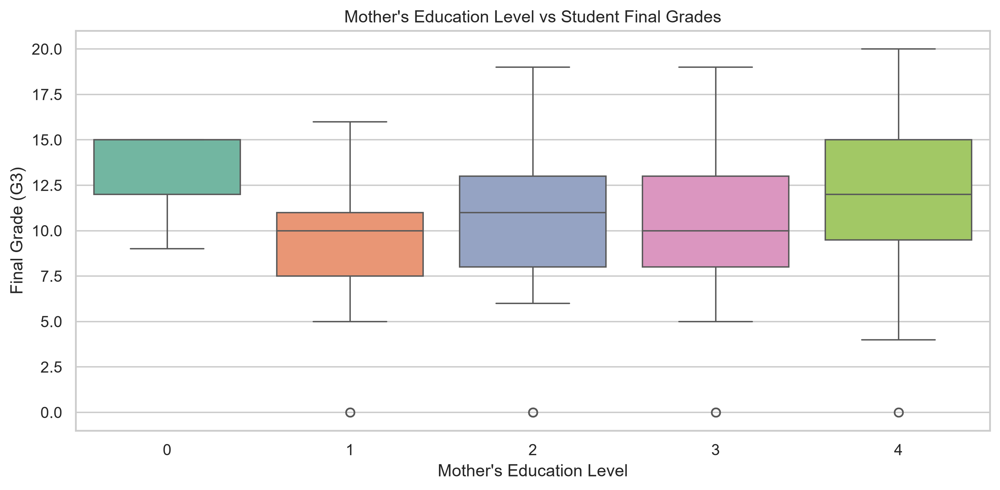

| Mother's Education | Students | Mean G3 |
|---:|---:|---:|
| 0 | 3 | 13.00 |
| 1 | 59 | 8.68 |
| 2 | 103 | 9.73 |
| 3 | 99 | 10.30 |
| 4 | 131 | 11.76 |

**Observations:**
- Students whose mothers had higher education levels generally showed higher average grades.
- The category with higher education had the highest average among the listed groups.
- The group with education level 0 contained only three students, so its mean should be interpreted cautiously.

### 10.2 Father's Education and Final Grades

**Visualization:** `outputs/father_education_vs_grades.png`

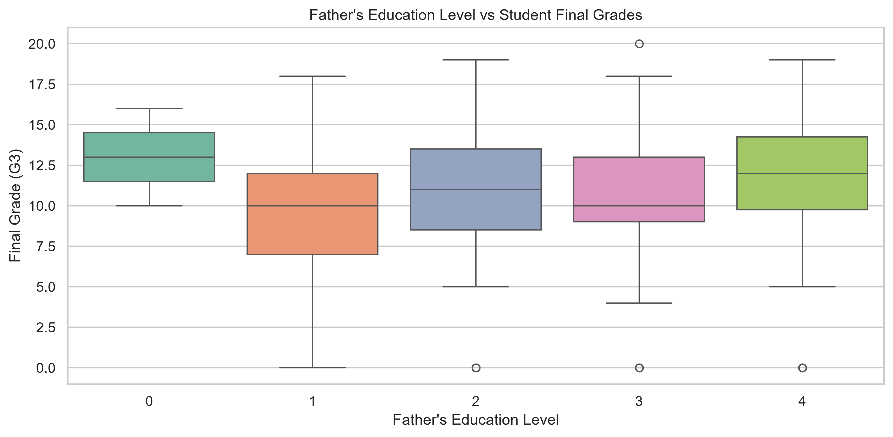

| Father's Education | Students | Mean G3 |
|---:|---:|---:|
| 0 | 2 | 13.00 |
| 1 | 82 | 9.16 |
| 2 | 115 | 10.26 |
| 3 | 100 | 10.66 |
| 4 | 96 | 11.36 |

**Observations:**
- Higher paternal education categories generally showed higher average final grades.
- The category with education level 4 had the highest average among the listed groups.
- The education level 0 category contained only two students and should not be generalized.

### 10.3 Comparison of Parental Education

**Visualization:** `outputs/parent_education_comparison.png`

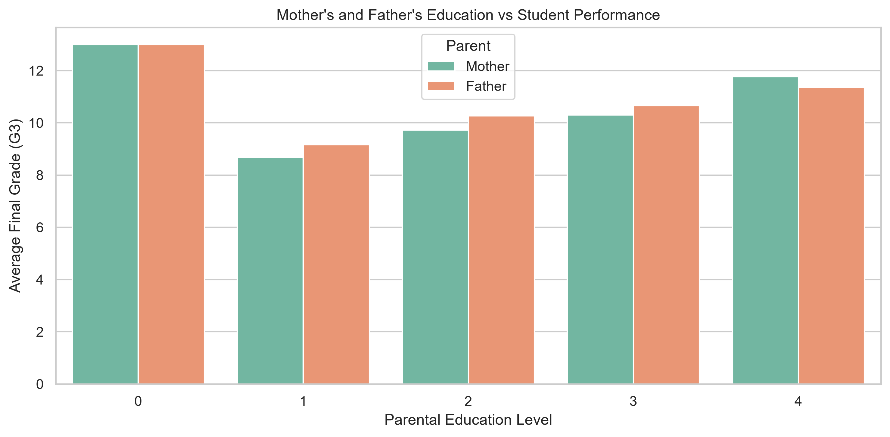

This comparison provides a combined view of the relationship between parental education and student academic performance.

---

## 11. Alcohol Consumption and Academic Performance

Weekday and weekend alcohol consumption were examined to explore their relationship with final mathematics grades.

The dataset uses a scale from 1 to 5:

| Category | Consumption Level |
|---:|:---|
| 1 | Very low |
| 2 | Low |
| 3 | Moderate |
| 4 | High |
| 5 | Very high |

### 11.1 Weekday Alcohol Consumption

**Visualization:** `outputs/weekday_alcohol_vs_grades.png`

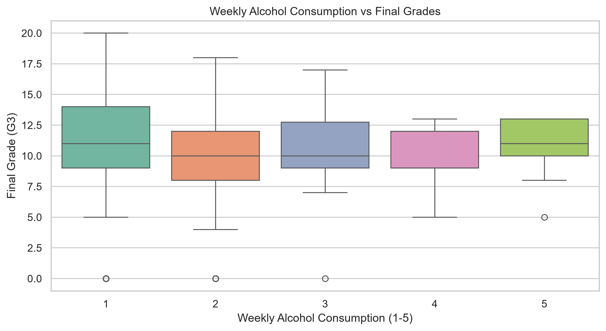

| Dalc | Students | Mean G3 |
|---:|---:|---:|
| 1 | 276 | 10.73 |
| 2 | 75 | 9.25 |
| 3 | 26 | 10.50 |
| 4 | 9 | 9.89 |
| 5 | 9 | 10.67 |

**Observations:**
- Most students belonged to weekday alcohol-consumption category 1.
- Average grades varied across the consumption categories.
- The small sample sizes in categories 4 and 5 limit the reliability of comparisons.

### 11.2 Weekend Alcohol Consumption

**Visualization:** `outputs/weekend_alcohol_vs_grades.png`

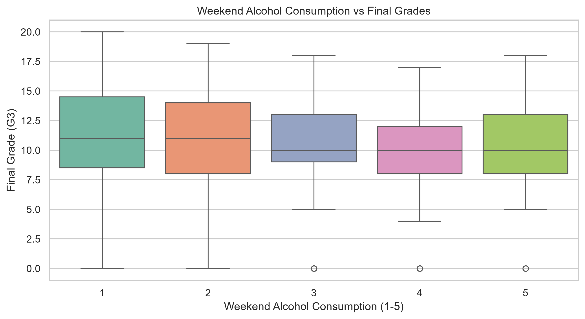

This visualization examines how weekend alcohol-consumption categories are distributed in relation to final grades.

### 11.3 Weekday and Weekend Alcohol Comparison

**Visualization:** `outputs/alcohol_comparison.png`

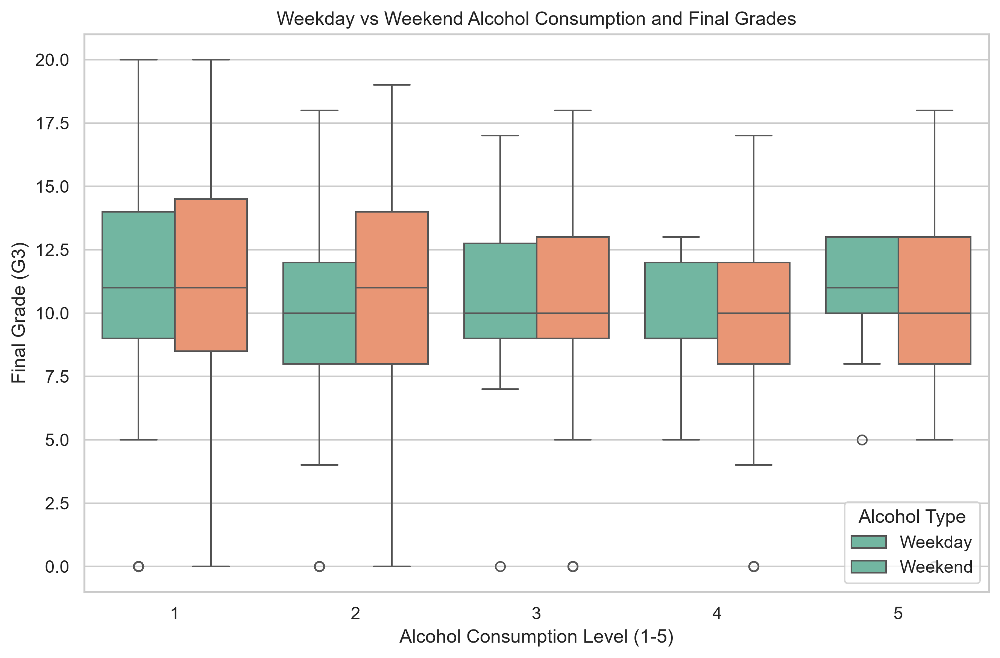

**Observations:**
- Weekend alcohol consumption was generally higher than weekday consumption.
- Weekday and weekend alcohol-consumption levels were positively correlated.
- The correlation between weekday and weekend consumption was approximately +0.648.
- Alcohol consumption showed only weak negative correlations with final grades.

### 11.4 Study Time and Alcohol Consumption

**Visualization:** `outputs/studytime_alcohol_scatter.png`

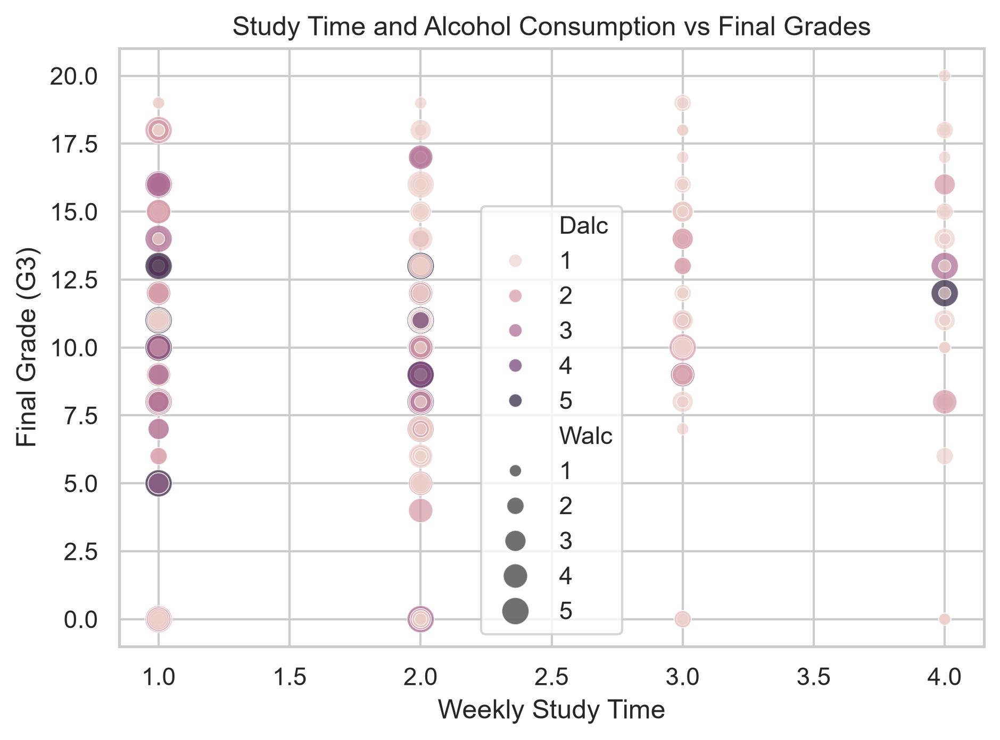

**Visualization:** `outputs/studytime_alcohol_combined_scatter.png`

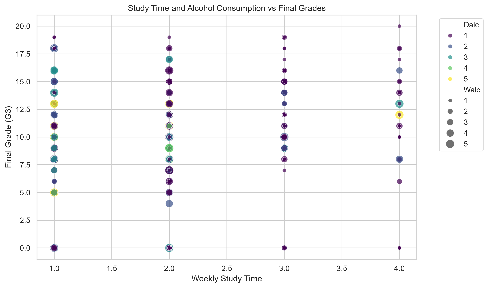

The combined visualizations explore the relationship between study time, alcohol consumption and final grades.

### 11.5 Study Time and Alcohol Consumption Heatmap

**Visualization:** `outputs/studytime_alcohol_heatmap.png`

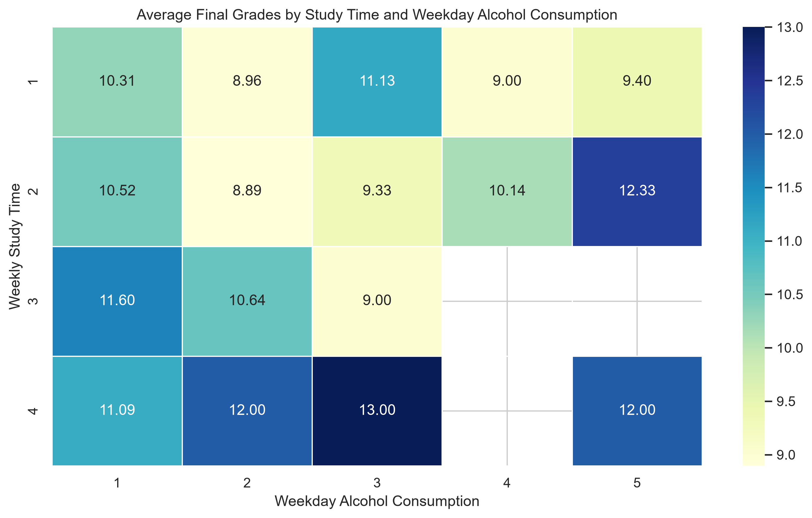

**Observations:**
- Study time showed negative correlations with weekday and weekend alcohol consumption.
- Students in higher study-time categories generally had lower average alcohol-consumption scores.
- The results describe associations within this dataset and do not demonstrate that one behavior causes another.

---

## 12. Free Time and Academic Performance

The relationship between free time after school and final mathematics grades was examined.

**Visualization:** `outputs/freetime_vs_grades.png`

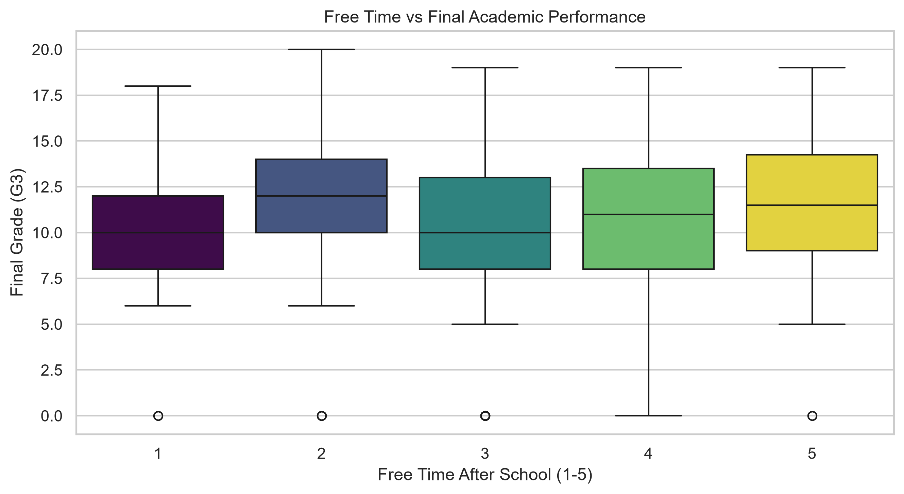

| Free Time Category | Students | Mean G3 |
|---:|---:|---:|
| 1 | 19 | 9.84 |
| 2 | 64 | 11.56 |
| 3 | 157 | 9.78 |
| 4 | 115 | 10.43 |
| 5 | 40 | 11.30 |

**Observations:**
- Average grades varied across free-time categories.
- Category 2 had the highest average grade.
- The relationship was not consistently increasing or decreasing.
- Free time alone does not provide a clear explanation of academic performance.

---

## 13. Going Out with Friends and Academic Performance

The frequency of going out with friends was compared with final mathematics grades.

**Visualization:** `outputs/goout_vs_grades.png`

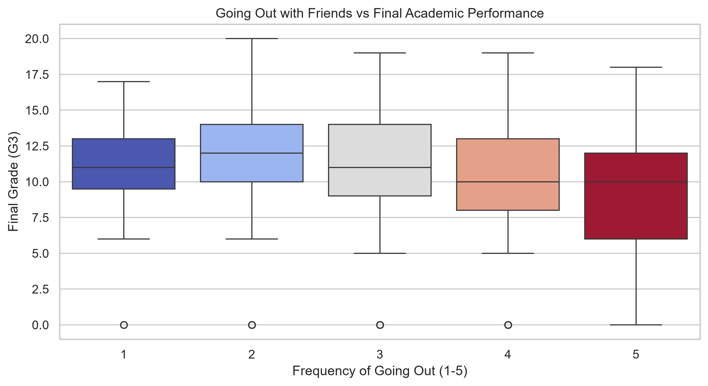

| Go Out Category | Students | Mean G3 |
|---:|---:|---:|
| 1 | 23 | 9.87 |
| 2 | 103 | 11.19 |
| 3 | 130 | 10.96 |
| 4 | 86 | 9.65 |
| 5 | 53 | 9.04 |

**Observations:**
- Students in category 2 recorded the highest average grade.
- Higher going-out frequency categories generally showed lower average grades.
- The correlation between going out and final grades was approximately -0.133.
- This is a weak negative relationship, not evidence of a causal effect.

---

## 14. Health Status and Academic Performance

The relationship between students' self-reported health status and final grades was examined.

**Visualization:** `outputs/health_vs_grades.png`

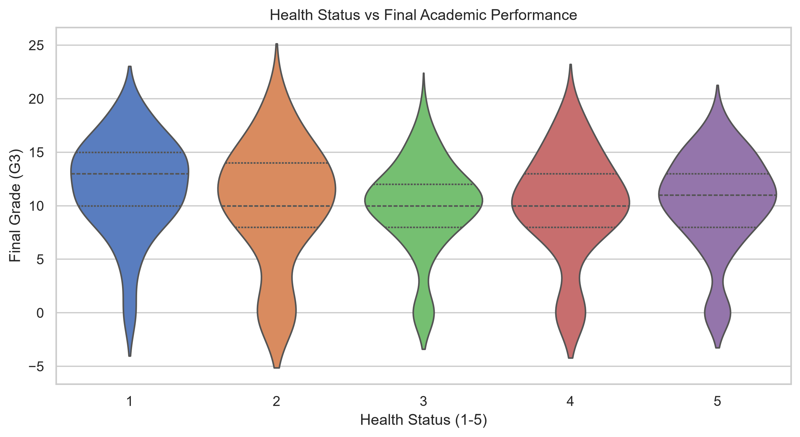

| Health Category | Students | Mean G3 |
|---:|---:|---:|
| 1 | 47 | 11.87 |
| 2 | 45 | 10.22 |
| 3 | 91 | 10.01 |
| 4 | 66 | 10.11 |
| 5 | 146 | 10.40 |

**Observations:**
- Average grades varied across health categories.
- Category 1 recorded the highest average grade.
- The correlation between health status and final grades was approximately -0.061.
- The linear relationship was very weak.

---

## 15. Internet Access and Academic Performance

The relationship between internet access at home and final mathematics grades was examined.

**Visualization:** `outputs/internet_vs_grades.png`

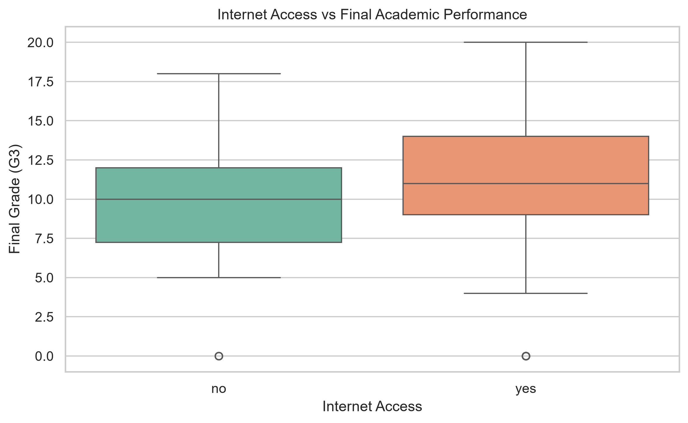

| Internet Access | Students | Mean G3 | Median G3 |
|:---|---:|---:|---:|
| No | 66 | 9.41 | 10 |
| Yes | 329 | 10.62 | 11 |

**Observations:**
- Most students had internet access at home.
- Students with internet access had a higher average final grade in this dataset.
- The difference is descriptive and does not establish that internet access directly improves academic performance.

---

## 16. Advanced Visualizations and Correlation Analysis

### 16.1 Lifestyle Pair Plot

**Visualization:** `outputs/lifestyle_pairplot.png`

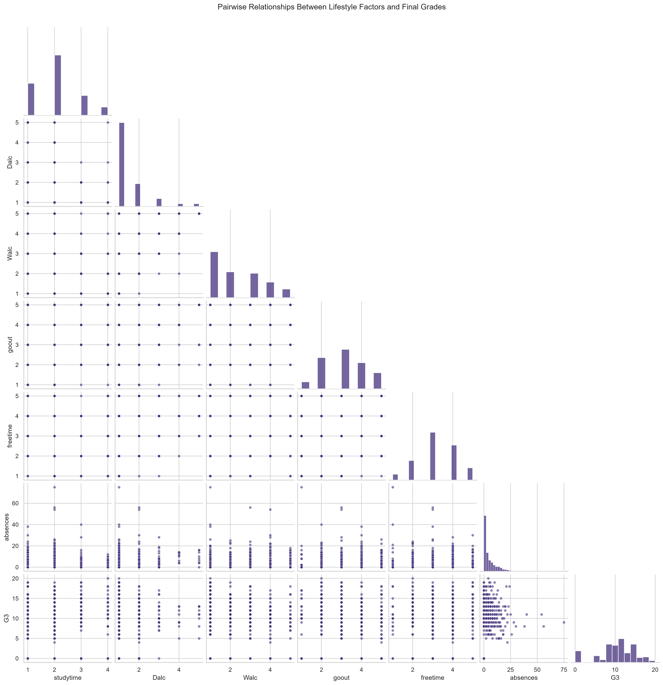

The pair plot provides a visual comparison of selected lifestyle variables and their distributions.

### 16.2 Correlation Heatmap

**Visualization:** `outputs/student_performance_correlation_heatmap.png`

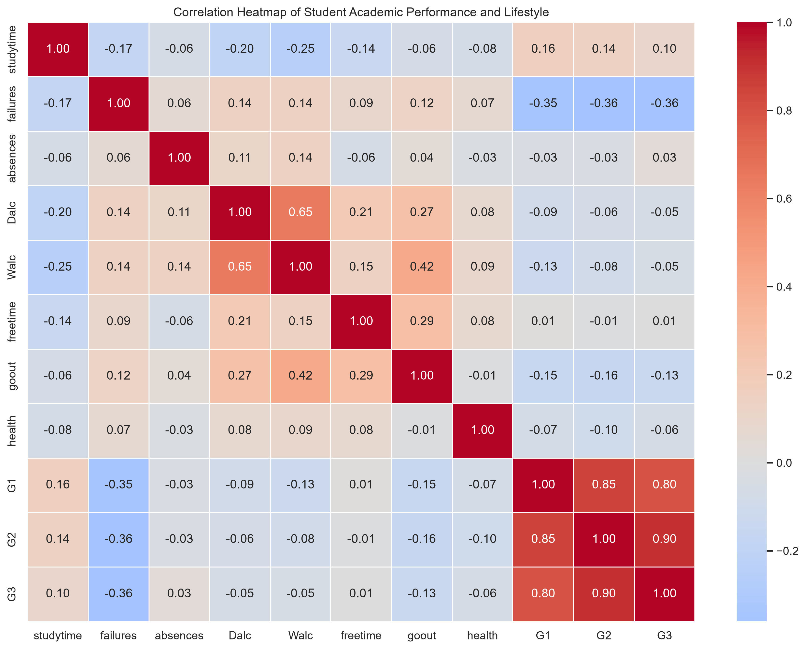

The correlation heatmap was used to identify the strength and direction of linear relationships among selected numerical variables.

### 16.3 Correlation with Final Grade

| Feature | Correlation with G3 |
|:---|---:|
| G3 | +1.000 |
| G2 | +0.905 |
| G1 | +0.801 |
| Study Time | +0.098 |
| Absences | +0.034 |
| Free Time | +0.011 |
| Weekend Alcohol | -0.052 |
| Weekday Alcohol | -0.055 |
| Health | -0.061 |
| Going Out | -0.133 |
| Past Failures | -0.360 |

**Key observations:**
- `G2` had the strongest positive correlation with `G3` among the listed features.
- `G1` also showed a strong positive correlation with final grades.
- Past failures showed a moderate negative correlation with final grades.
- Study time showed a weak positive correlation.
- Absences and free time had correlations close to zero.
- Alcohol consumption, health and going out showed weak negative correlations.

**Interpretation:** Correlation measures linear association. It does not establish causation, and the strong relationships between earlier grades and final grades should be interpreted in the context of their shared academic measurement.

---

## 17. Key Findings

The exploratory analysis produced the following findings:

1. The dataset contains 395 student records and 33 features.
2. No missing values or duplicate records were identified.
3. The average final mathematics grade was approximately 10.42.
4. Previous-period grades (`G1` and `G2`) were strongly positively correlated with final grades.
5. Students with no previous class failures had higher average final grades than students with previous failures.
6. Study-time categories 3 and 4 had higher average final grades than categories 1 and 2.
7. Parental education levels showed generally positive descriptive patterns with average final grades.
8. Absences had a very weak linear correlation with final grades.
9. Weekday and weekend alcohol consumption were positively correlated with each other.
10. Internet access groups showed different average grades, with the internet-access group having a higher mean.
11. Lifestyle variables generally showed weaker correlations with final grades than previous academic grades.
12. Several group comparisons involved small sample sizes and should be interpreted cautiously.

---

## 18. Limitations

Although the analysis provides useful insights, several limitations should be considered:

- The dataset represents a specific educational context and may not generalize to all student populations.
- The analysis identifies associations rather than causal relationships.
- Some categorical groups contain relatively few students.
- Self-reported lifestyle information may contain reporting inaccuracies.
- Correlation analysis captures linear relationships and may not identify complex patterns.
- The analysis focuses on mathematics performance and does not represent overall academic achievement.
- The results do not account for every possible factor influencing student performance.

---

## 19. Conclusion

- This project explored student academic performance using Python, Pandas, NumPy, Seaborn and Matplotlib.

- The analysis examined academic history, study time, past failures, absences, parental education, alcohol consumption, free time, social activities, health and internet access.

- The findings indicate that previous academic grades had the strongest positive relationships with final mathematics grades, while past failures showed a negative relationship. Study time and parental education also displayed useful descriptive patterns.

- The project demonstrates how data analysis and statistical visualization can be used to explore educational datasets, identify patterns and communicate findings effectively.

- The conclusions are based on exploratory analysis and should not be interpreted as proof of causation.

---


## 20. Skills Demonstrated

| Skill | Application |
|:---|:---|
| Python | Data analysis programming |
| NumPy | Numerical computation |
| Pandas | Data loading, cleaning and manipulation |
| Seaborn | Statistical data visualization |
| Matplotlib | Plot creation and customization |
| Exploratory Data Analysis | Identifying patterns and trends |
| Descriptive Statistics | Summarizing numerical variables |
| Correlation Analysis | Exploring variable relationships |
| Data Interpretation | Communicating analytical findings |
| Jupyter Notebook | Interactive analysis workflow |
| Git and GitHub | Project version control and documentation |

### 20.1 Key Learning Outcomes

Through this project, I gained practical experience in:

- Loading and inspecting real-world datasets.
- Understanding dataset structure and data types.
- Checking missing values and duplicate records.
- Performing exploratory data analysis.
- Calculating descriptive statistics.
- Analyzing relationships between academic and lifestyle variables.
- Creating and customizing statistical visualizations.
- Interpreting correlation results.
- Documenting analytical findings in Markdown.
- Organizing and maintaining a data analysis project using GitHub.

---

## 21. Future Scope

The project can be extended through the following improvements:

1. **Statistical Testing:** Apply hypothesis testing to investigate whether observed group differences are statistically significant.
2. **Feature Engineering:** Create additional analytical variables from existing features.
3. **Machine Learning:** Develop models to predict students' final mathematics grades.
4. **Model Comparison:** Compare Linear Regression, Decision Tree Regressor and Random Forest Regressor.
5. **Model Evaluation:** Evaluate predictive performance using MAE, MSE, RMSE and R².
6. **Feature Importance:** Identify variables that contribute to model predictions.
7. **Interactive Dashboard:** Develop an interactive dashboard for exploring student performance.
8. **Advanced Analysis:** Extend the study using additional educational datasets.

---

## 22. Project Information and Author

| Attribute | Details |
|:---|:---|
| Project Title | Student Academic Performance & Lifestyle Analysis |
| Project Category | Exploratory Data Analysis |
| Domain | Data Science |
| Dataset | UCI Student Performance — Mathematics |
| Programming Language | Python |
| Analysis Environment | Jupyter Notebook |
| Visualization Libraries | Seaborn and Matplotlib |
| Author | ASWIN KUMAR V |
| Academic Program | B.Tech — Artificial Intelligence and Data Science |

### Author Profiles

- **GitHub:** [aswinkumarv23451-cpu](https://github.com/aswinkumarv23451-cpu)
- **LinkedIn:** [ASWIN KUMAR V](https://www.linkedin.com/in/aswin-kumar-v-740724426/)

---

**END OF ANALYSIS REPORT**