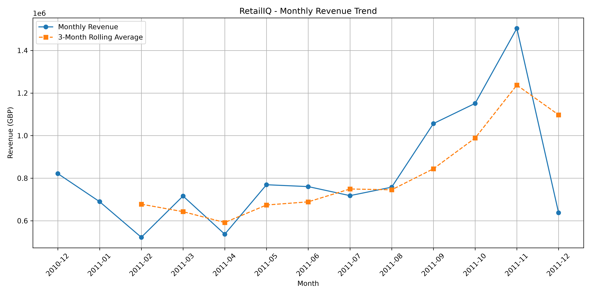
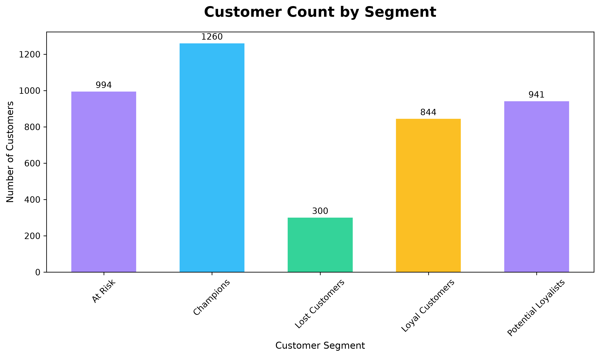
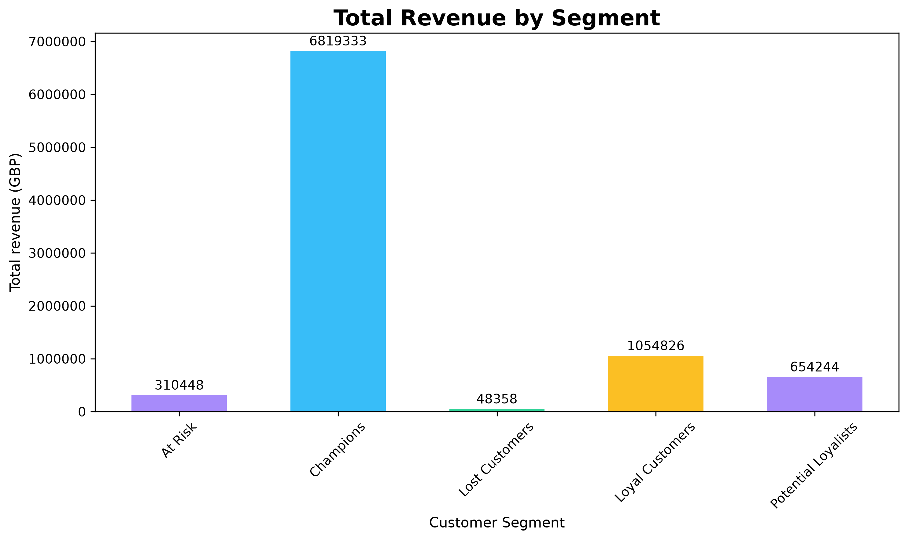
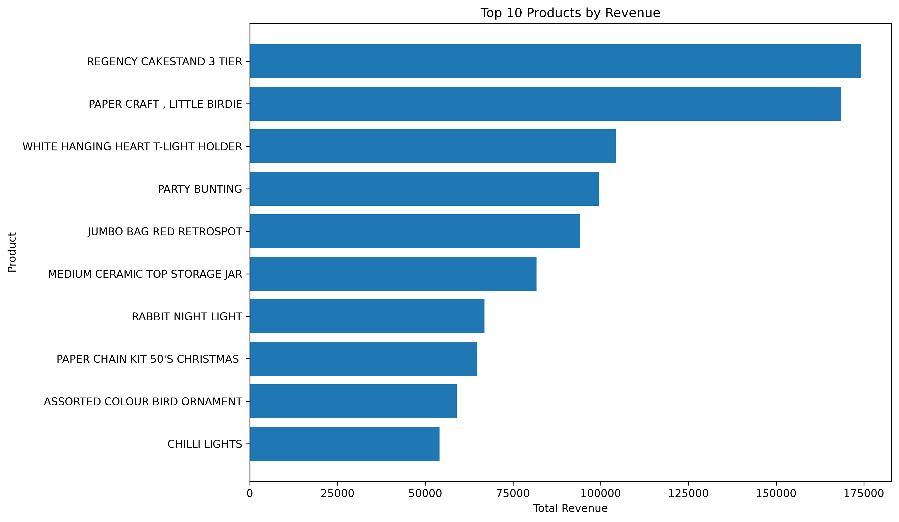
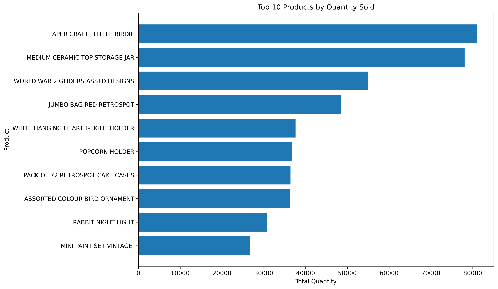

<div align="center">

# RetailIQ

### E-Commerce Business Intelligence & Customer Analytics

**Turning Retail Data into Actionable Business Insights**

---

*A Python-powered data analytics project exploring sales performance, product trends, customer purchasing behaviour, and business intelligence.*

</div>

## Overview

- **RetailIQ** is an exploratory data analytics project built using Python and its data science libraries to uncover meaningful insights from real-world e-commerce transaction data.

- The project focuses on transforming raw retail records into structured information through data cleaning, exploratory data analysis, revenue analysis, product performance evaluation, and RFM-based customer segmentation.

- By examining sales patterns and customer behaviour, RetailIQ demonstrates how data analytics can support informed business decisions.

## Project Objectives

- Analyze e-commerce sales performance and revenue distribution.
- Identify top-performing products by revenue and quantity.
- Examine monthly sales trends and order patterns.
- Understand customer purchasing behaviour.
- Implement RFM analysis for customer segmentation.
- Extract actionable business insights through data visualization.

## Dataset

**UCI Online Retail Dataset**

The dataset contains historical transactions from a UK-based online retail business.

| Dataset Attribute | Value |
|:--|--:|
| Initial Transactions | 541,909 |
| Features | 8 |
| Countries | 38 |
| Unique Customer IDs | 4,372 |
| Final Cleaned Records | 535,187 |
| Customers Analyzed | 4,339 |
| Products Analyzed | 4,316 |

**Dataset Source:** [UCI Machine Learning Repository – Online Retail](https://archive.ics.uci.edu/dataset/352/online+retail)

## Technology Stack

| Technology | Application |
|:--|:--|
| Python | Core programming |
| Pandas | Data manipulation and analysis |
| NumPy | Numerical computations |
| Matplotlib | Data visualization |
| Seaborn | Statistical visualization |
| Jupyter Notebook | Interactive analysis |

## Analytical Workflow

The project follows a structured data analytics workflow:

1. **Data Loading** – Importing the raw retail dataset.
2. **Data Exploration** – Examining dataset structure, distributions, missing values, and duplicates.
3. **Data Cleaning** – Removing duplicate records and handling missing product descriptions.
4. **Feature Engineering** – Calculating revenue and classifying transaction types.
5. **Sales Analysis** – Evaluating country-wise revenue and monthly performance.
6. **Customer Analysis** – Calculating customer-level purchasing metrics.
7. **RFM Segmentation** – Categorizing customers based on Recency, Frequency, and Monetary values.
8. **Product Analysis** – Identifying high-performing products.
9. **Visualization** – Presenting findings through charts.
10. **Business Insights** – Interpreting results and developing recommendations.

## Key Results & Business Insights

### Sales Performance

| Metric | Result |
|:--|--:|
| Sales Transactions | 525,460 |
| Highest Revenue Country | United Kingdom |
| UK Revenue | £9,001,744.09 |
| Highest Revenue Month | November 2011 |
| November Revenue | £1,503,866.78 |

### Customer Segmentation

A rule-based RFM model was implemented to categorize customers into five segments.

| Customer Segment | Customers |
|:--|--:|
| Champions | 1,260 |
| Loyal Customers | 844 |
| Potential Loyalists | 941 |
| At Risk | 994 |
| Lost Customers | 300 |
| **Total** | **4,339** |

**Key Insight:** Champions generated the highest customer-segment revenue, contributing £6,819,332.77.

### Product Performance

| Metric | Result |
|:--|:--|
| Products Analyzed | 4,316 |
| Highest Revenue Product | REGENCY CAKESTAND 3 TIER |
| Highest Quantity Product | PAPER CRAFT , LITTLE BIRDIE |
| Average Product Revenue | £2,381.84 |

**Key Insight:** The product generating the highest revenue differs from the product selling the highest quantity, demonstrating the importance of evaluating both metrics.

## Data Visualizations

The following visualizations summarize the major findings from the analysis.

### 1. Monthly Revenue Trend

Examines revenue changes across months and highlights the three-month rolling average.



### 2. Customer Distribution by Segment

Illustrates the distribution of customers across the five RFM segments.



### 3. Revenue by Customer Segment

Compares the revenue contribution of each customer segment.



### 4. Top 10 Products by Revenue

Highlights the products generating the highest revenue.



### 5. Top 10 Products by Quantity

Identifies products with the highest total quantities sold.



## Project Structure

```text
RetailIQ/
│
├── data/
│   └── online_retail.xlsx
│
├── outputs/
│   └── charts/
│       ├── monthly_revenue_trend.png
│       ├── customer_count_by_segment.png
│       ├── revenue_by_customer_segment.png
│       ├── top_10_products_by_revenue.png
│       └── top_10_products_by_quantity.png
│
├── analysis.ipynb
├── README.md
└── analysis.md
```

## Skills Demonstrated

- Python programming
- Data cleaning and preprocessing
- Exploratory Data Analysis (EDA)
- Pandas data manipulation
- NumPy numerical operations
- GroupBy and aggregation
- Datetime feature engineering
- RFM customer segmentation
- Business intelligence
- Data visualization
- Analytical thinking and interpretation

## Detailed Project Documentation

For the complete explanation of the methodology, data preprocessing, calculations, analytical findings, visualizations, business insights, and recommendations, refer to:

**[Read the Complete RetailIQ Analysis Report →](/mini_projects/04_Pandas/RetailIQ/docs/analysis.md)**

## Conclusion

- RetailIQ demonstrates the practical application of Python-based data analytics to real-world retail transaction data.

- By combining data preprocessing, exploratory analysis, customer segmentation, product performance evaluation, and visualization, the project transforms transactional information into meaningful business insights.

- It provides a foundation for understanding how data-driven approaches can support customer retention, revenue analysis, product strategy, and business decision-making.

---

<div align="center">

## 👨‍💻 About the Author

**ASWIN KUMAR V**

B.Tech — Artificial Intelligence and Data Science


<p align="center">
  <a href="https://github.com/aswinkumarv23451-cpu">GitHub Profile</a> |
  <a href="https://www.linkedin.com/in/aswin-kumar-v-740724426/">LinkedIn</a>
</p>

---

<p align="center">
  <strong>Learning by Building | Exploring Data | Turning Insights into Knowledge</strong>
</p>