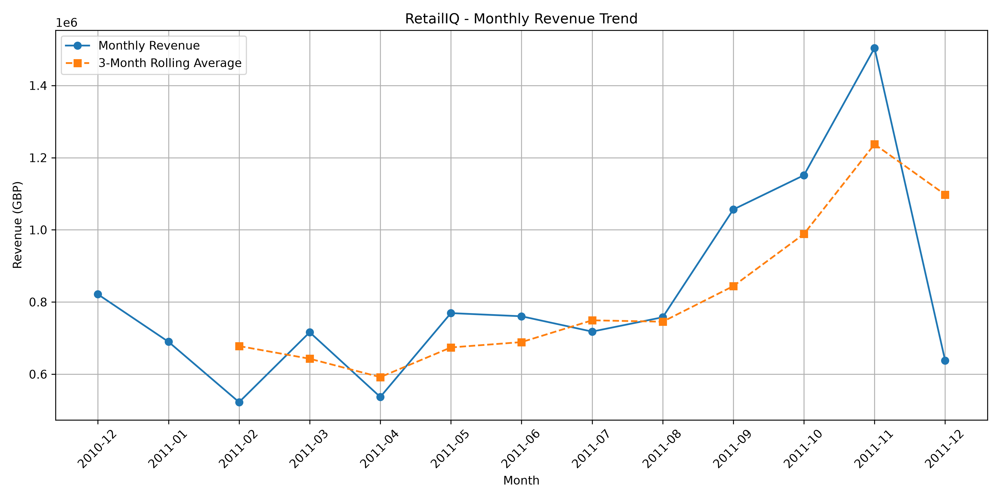
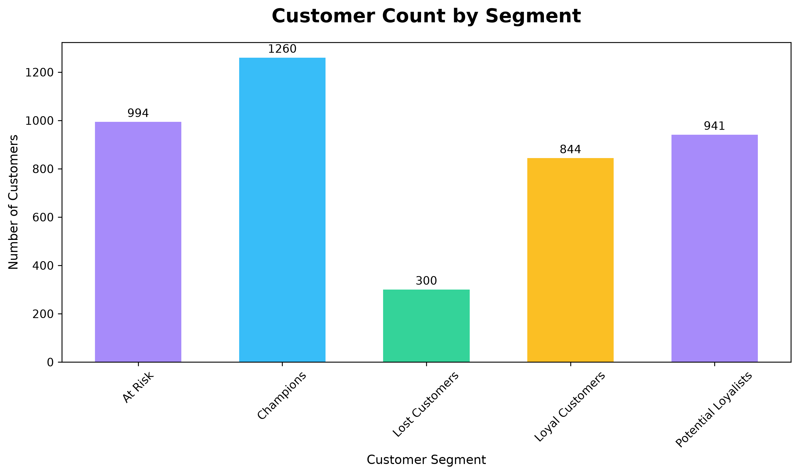
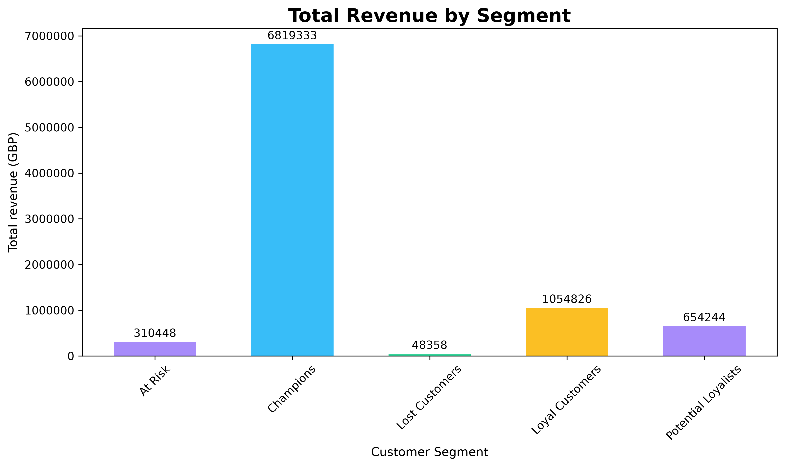
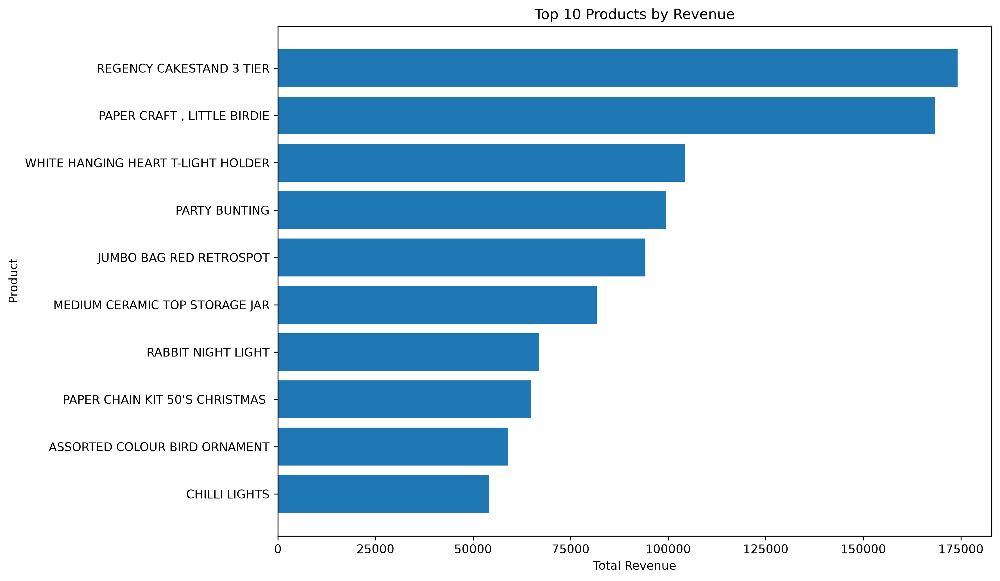
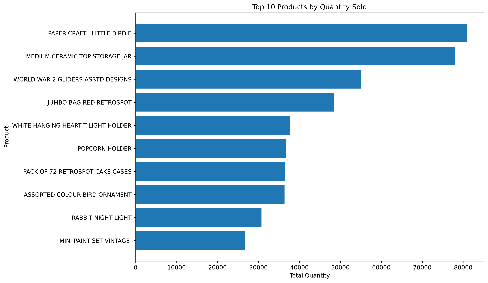

# RetailIQ

### E-Commerce Business Intelligence & Customer Analytics

**DATA ANALYTICS | PYTHON | PANDAS | NUMPY | MATPLOTLIB | SEABORN**

*Transforming retail transaction data into meaningful business insights.*

---

## 1. Project Overview

**RetailIQ** is an exploratory data analytics project designed to understand e-commerce sales performance, product trends, customer purchasing behaviour, and business performance using Python.

The project analyzes historical retail transaction data to identify revenue patterns, evaluate product performance, understand customer purchasing behaviour, and segment customers using the RFM (Recency, Frequency, Monetary) model.

### Objectives

- Analyze overall e-commerce sales and revenue performance.
- Identify top-performing products based on revenue and quantity.
- Examine monthly revenue and order trends.
- Understand customer purchasing behaviour.
- Apply RFM analysis for customer segmentation.
- Generate meaningful business insights and recommendations through data visualization.

## 2. Dataset Description

**Dataset:** UCI Online Retail Dataset

**Source:** [UCI Machine Learning Repository](https://archive.ics.uci.edu/dataset/352/online+retail)

The dataset contains transactional records from a UK-based online retail business.

### Dataset Information

| Attribute | Details |
|:--|--:|
| Initial Records | 541,909 |
| Initial Features | 8 |
| Unique Customers | 4,372 |
| Unique Products (Stock Codes) | 4,070 |
| Countries | 38 |
| Duplicate Records | 5,268 |
| Missing Descriptions | 1,454 |
| Missing Customer IDs | 135,080 |

### Dataset Features

| Column | Description |
|:--|:--|
| InvoiceNo | Unique invoice number |
| StockCode | Product identification code |
| Description | Product name |
| Quantity | Number of products purchased |
| InvoiceDate | Date and time of transaction |
| UnitPrice | Price per unit |
| CustomerID | Unique customer identifier |
| Country | Customer's country |

## 3. Tools and Technologies

| Technology | Purpose |
|:--|:--|
| Python | Programming and analysis |
| Pandas | Data manipulation and analysis |
| NumPy | Numerical operations |
| Matplotlib | Data visualization |
| Seaborn | Statistical visualization |
| Jupyter Notebook | Interactive development environment |

## 4. Data Exploration

The initial dataset was examined to understand its structure, data types, statistical properties, missing values, duplicates, and unusual transaction records.

### 4.1 Initial Dataset Inspection

The dataset initially contained:

- 541,909 transaction records.
- 8 columns.
- 4,372 unique customer IDs.
- 4,070 unique stock codes.
- 38 countries.

### 4.2 Data Quality Analysis

| Data Quality Check | Result |
|:--|--:|
| Duplicate Records | 5,268 |
| Missing Descriptions | 1,454 |
| Missing Customer IDs | 135,080 |
| Zero Unit Prices | 2,515 |
| Negative Unit Prices | 2 |
| Negative Quantity Records | 10,624 |

### 4.3 Observations

- Duplicate records were identified and removed.
- Missing customer IDs were retained in the general transaction dataset but excluded from customer-level RFM analysis.
- Zero-priced transactions were identified for further consideration.
- Negative quantities and cancellation invoices required separate transaction classification.
- Two negative unit-price records were identified as bad debt adjustments.

## 5. Data Cleaning and Preprocessing

Data cleaning was performed to improve the reliability of subsequent analysis.

### 5.1 Duplicate Removal

Duplicate transaction records were removed.

| Metric | Records |
|:--|--:|
| Before Cleaning | 541,909 |
| Duplicate Records Removed | 5,268 |
| After Duplicate Removal | 536,641 |

### 5.2 Missing Description Handling

Records with missing product descriptions were removed.

| Metric | Records |
|:--|--:|
| Before Removing Missing Descriptions | 536,641 |
| Missing Descriptions Removed | 1,454 |
| Final Cleaned Records | 535,187 |

### 5.3 Revenue Calculation

A new feature named `Revenue` was created by multiplying the transaction quantity by the unit price.

**Revenue = Quantity × UnitPrice**

This feature was used to evaluate transaction-level and product-level revenue.

### 5.4 Transaction Classification

Transactions were classified into four major categories based on invoice numbers, quantity, and unit price.

| Transaction Type | Records |
|:--|--:|
| Sale | 525,460 |
| Cancellation | 9,251 |
| Return | 474 |
| Adjustment | 2 |
| **Total** | **535,187** |

**Classification Logic:**

- **Sale:** Positive quantity transactions.
- **Cancellation:** Transactions with invoice numbers beginning with `C`.
- **Return:** Negative quantity transactions outside cancellation invoices.
- **Adjustment:** Transactions with negative unit prices.

The classification order gives cancellation invoices priority over other conditions.

> **Note:** The 474 negative-quantity records outside cancellation invoices have zero unit prices. They are classified as return-like records based on the available transaction fields and should not automatically be interpreted as confirmed customer refunds.

### 5.5 Sales Dataset

A separate dataset named `sales` was created by selecting records classified as `Sale`.

**Total Sales Records: 525,460**

This dataset was used for sales, revenue, monthly trend, and customer analysis.

## 6. Sales and Revenue Analysis

Sales analysis was performed to understand the geographical distribution of revenue and identify important business markets.

### 6.1 Country-wise Revenue Analysis

The top-performing countries based on total sales revenue were identified.

| Rank | Country | Revenue (£) |
|--:|:--|--:|
| 1 | United Kingdom | 9,001,744.09 |
| 2 | Netherlands | 285,446.34 |
| 3 | EIRE | 283,140.52 |
| 4 | Germany | 228,678.40 |
| 5 | France | 209,625.37 |
| 6 | Australia | 138,453.81 |
| 7 | Spain | 61,558.56 |
| 8 | Switzerland | 57,067.60 |
| 9 | Belgium | 41,196.34 |
| 10 | Sweden | 38,367.83 |

### Key Observation

The United Kingdom contributes the largest share of revenue by a substantial margin compared with other countries.

This indicates a strong concentration of business revenue in the UK market.

## 7. Monthly Sales Trend Analysis

Monthly sales analysis was performed to understand changes in revenue and order volume over time.

The transaction date was converted into a datetime format, and year, month, and year-month features were extracted.

### 7.1 Monthly Revenue

| Month | Revenue (£) |
|:--|--:|
| Dec 2010 | 821,452.73 |
| Jan 2011 | 689,811.61 |
| Feb 2011 | 522,545.56 |
| Mar 2011 | 716,215.26 |
| Apr 2011 | 536,968.49 |
| May 2011 | 769,296.61 |
| Jun 2011 | 760,547.01 |
| Jul 2011 | 718,076.12 |
| Aug 2011 | 757,841.38 |
| Sep 2011 | 1,056,435.19 |
| Oct 2011 | 1,151,263.73 |
| Nov 2011 | 1,503,866.78 |
| Dec 2011 | 637,790.33 |

### 7.2 Monthly Order Analysis

Monthly order volume was calculated using the number of unique invoice numbers.

| Month | Unique Orders |
|:--|--:|
| Dec 2010 | 1,566 |
| Jan 2011 | 1,089 |
| Feb 2011 | 1,101 |
| Mar 2011 | 1,459 |
| Apr 2011 | 1,255 |
| May 2011 | 1,689 |
| Jun 2011 | 1,538 |
| Jul 2011 | 1,485 |
| Aug 2011 | 1,365 |
| Sep 2011 | 1,858 |
| Oct 2011 | 2,070 |
| Nov 2011 | 2,830 |
| Dec 2011 | 829 |

### 7.3 Three-Month Rolling Average

A three-month rolling average was calculated to identify the underlying revenue trend while reducing short-term fluctuations.

The rolling average showed a general increase in revenue during the later months of 2011, reaching approximately £1.24 million in November 2011.

**Visualization:**

*Figure 1: Monthly Revenue Trend*

**Observation:** November 2011 recorded the highest monthly revenue and order volume in the available dataset.

> **Note:** December 2011 contains data only up to December 9, so it represents a partial month and should not be directly compared with complete months.

## 8. Customer Analysis

Customer analysis was conducted to understand purchasing frequency, spending behaviour, and customer contribution to overall revenue.

### 8.1 Customer-level Aggregation

Records without CustomerID were excluded from customer-level analysis.

The customer dataset was grouped by `CustomerID` to calculate:

| Metric | Description |
|:--|:--|
| Last Purchase | Most recent purchase date |
| Frequency | Number of unique invoices |
| Monetary | Total purchase revenue |
| Recency | Days since the most recent purchase |

**Total Customers Analyzed: 4,339**

## 9. RFM Analysis and Customer Segmentation

RFM analysis was implemented to evaluate customer behaviour using three important metrics:

- **Recency (R):** How recently a customer made a purchase.
- **Frequency (F):** How frequently a customer made purchases.
- **Monetary (M):** How much revenue a customer generated.

### 9.1 RFM Score Calculation

Each customer received an individual score from 1 to 4 for each RFM metric.

| Metric | Scoring Logic |
|:--|:--|
| Recency | More recent purchases receive higher scores |
| Frequency | Higher purchase frequency receives higher scores |
| Monetary | Higher spending receives higher scores |

The scores were calculated using quartile-based ranking with `pandas.qcut()`.

### 9.2 RFM Score and Total

Two separate features were created:

- `RFM_Score`: Concatenation of the three individual scores.
- `RFM_Total`: Numerical sum of the three individual scores.

**Example:**

| R Score | F Score | M Score | RFM Score | RFM Total |
|--:|--:|--:|--:|--:|
| 4 | 4 | 4 | 444 | 12 |
| 2 | 3 | 4 | 234 | 9 |
| 1 | 1 | 4 | 114 | 6 |

### 9.3 Customer Segmentation

Customers were divided into five segments using their RFM total.

| RFM Total | Customer Segment |
|--:|:--|
| 10–12 | Champions |
| 8–9 | Loyal Customers |
| 6–7 | Potential Loyalists |
| 4–5 | At Risk |
| 3 | Lost Customers |

### 9.4 Customer Segment Distribution

| Customer Segment | Customer Count |
|:--|--:|
| Champions | 1,260 |
| At Risk | 994 |
| Potential Loyalists | 941 |
| Loyal Customers | 844 |
| Lost Customers | 300 |
| **Total** | **4,339** |

**Visualization:**

*Figure 2: Customer Distribution by RFM Segment*

### 9.5 Revenue by Customer Segment

| Customer Segment | Customers | Total Revenue (£) | Average Revenue (£) |
|:--|--:|--:|--:|
| Champions | 1,260 | 6,819,332.77 | 5,412.17 |
| At Risk | 994 | 310,448.20 | 312.32 |
| Potential Loyalists | 941 | 654,243.61 | 695.26 |
| Loyal Customers | 844 | 1,054,826.08 | 1,249.79 |
| Lost Customers | 300 | 48,358.23 | 161.19 |

**Visualization:**

*Figure 3: Revenue Contribution by Customer Segment*

### Customer Analysis Observations

- Champions contribute the largest share of customer revenue.
- At Risk customers form a substantial segment, indicating an opportunity for customer retention campaigns.
- Potential Loyalists represent customers who may be encouraged to purchase more frequently.
- Lost Customers contribute comparatively low revenue.
- Loyal Customers provide a meaningful revenue contribution through repeat purchasing behaviour.

## 10. Product Performance Analysis

Product-level analysis was performed to identify high-revenue products and products with the highest sales quantities.

### 10.1 Product Data Preparation

Service-related stock codes such as `POST`, `DOT`, and `M` were excluded from the final product analysis.

The analysis was conducted using product transaction records grouped by StockCode and Description.

The following metrics were calculated:

- Total Quantity
- Total Revenue
- Total Orders

### 10.2 Product Analysis Summary

| Metric | Result |
|:--|:--|
| Total Products Analyzed | 4,316 |
| Highest Revenue Product | REGENCY CAKESTAND 3 TIER |
| Highest Quantity Product | PAPER CRAFT , LITTLE BIRDIE |
| Average Product Revenue (£) | 2,381.84 |

### 10.3 Top 10 Products by Revenue

| Rank | Product | Total Revenue (£) |
|--:|:--|--:|
| 1 | REGENCY CAKESTAND 3 TIER | 174,156.54 |
| 2 | PAPER CRAFT , LITTLE BIRDIE | 168,469.60 |
| 3 | WHITE HANGING HEART T-LIGHT HOLDER | 104,284.24 |
| 4 | PARTY BUNTING | 99,445.23 |
| 5 | JUMBO BAG RED RETROSPOT | 94,159.81 |
| 6 | MEDIUM CERAMIC TOP STORAGE JAR | 81,700.92 |
| 7 | RABBIT NIGHT LIGHT | 66,870.03 |
| 8 | PAPER CHAIN KIT 50'S CHRISTMAS | 64,875.59 |
| 9 | ASSORTED COLOUR BIRD ORNAMENT | 58,927.62 |
| 10 | CHILLI LIGHTS | 54,096.36 |

**Visualization:**

*Figure 4: Top 10 Products by Revenue*

### 10.4 Top Products by Quantity

The product with the highest total quantity sold was:

**PAPER CRAFT , LITTLE BIRDIE — 80,995 units**

The product with the highest revenue was:

**REGENCY CAKESTAND 3 TIER — £174,156.54**

**Visualization:**

*Figure 5: Top 10 Products by Quantity Sold*

### Product Analysis Observations

- REGENCY CAKESTAND 3 TIER generated the highest product revenue.
- PAPER CRAFT , LITTLE BIRDIE recorded the highest total quantity.
- High sales quantity does not necessarily indicate the highest revenue.
- Product performance should be evaluated using both quantity and revenue.
- PAPER CRAFT , LITTLE BIRDIE recorded 80,995 units across one unique invoice in this analysis, making it a notable result that deserves further investigation.

## 11. Key Business Insights

The analysis produced the following business insights:

### 1. Strong UK Market Contribution

The United Kingdom generated significantly more revenue than other countries, demonstrating the business's strong dependence on its primary market.

### 2. Seasonal Revenue Growth

Revenue increased considerably during September, October, and November 2011, with November recording the highest monthly revenue.

### 3. High-Value Customer Contribution

Champions generated the largest revenue contribution, highlighting the importance of retaining high-value customers.

### 4. Customer Retention Opportunity

The At Risk segment contains 994 customers. Targeted retention strategies may help encourage these customers to make future purchases.

### 5. Different Product Performance Patterns

The highest-revenue product and highest-quantity product are different, showing why both metrics are important in product performance analysis.

### 6. Transaction Data Quality Matters

Duplicate records, missing values, cancellations, returns, and unusual transactions must be handled carefully to improve the reliability of business insights.

## 12. Business Recommendations

Based on the findings, the following recommendations can be considered:

| Area | Recommendation |
|:--|:--|
| Customer Retention | Develop targeted campaigns for At Risk customers |
| Customer Loyalty | Introduce loyalty rewards for Champions and Loyal Customers |
| Customer Engagement | Encourage Potential Loyalists through personalized offers |
| Product Strategy | Prioritize inventory planning for high-performing products |
| Revenue Growth | Investigate opportunities in markets outside the UK |
| Seasonal Planning | Prepare inventory and promotional campaigns ahead of high-revenue periods |
| Data Quality | Regularly monitor duplicates, missing values, and unusual transactions |

These recommendations are based on historical transaction patterns and can support further business investigation.

## 13. Project Limitations

- The analysis uses historical transactional data rather than real-time business information.
- Customer-level analysis excludes records without CustomerID.
- RFM segmentation thresholds are rule-based and may be adjusted for different business objectives.
- Transaction classification is based on available invoice, quantity, and price fields.
- The December 2011 data represents only a partial month.
- Product-level anomalies require further investigation before drawing operational conclusions.

## 14. Conclusion

RetailIQ demonstrates how Python-based data analytics can transform raw e-commerce transaction records into meaningful business insights.

Through data exploration, cleaning, feature engineering, sales analysis, product performance analysis, monthly trend analysis, and RFM-based customer segmentation, the project identifies important patterns in revenue generation and customer purchasing behaviour.

The findings highlight the importance of customer retention, product performance monitoring, geographical revenue analysis, and data quality management.

Overall, RetailIQ provides a practical foundation for understanding e-commerce business intelligence and demonstrates the application of Python and Pandas in real-world data analysis.

## 15. Project Visualizations

All generated charts are available in the project's `outputs/charts/` directory.

| Figure | Visualization |
|:--|:--|
| 1 | Monthly Revenue Trend |
| 2 | Customer Count by Segment |
| 3 | Revenue by Customer Segment |
| 4 | Top 10 Products by Revenue |
| 5 | Top 10 Products by Quantity |

## 16. Technologies and Skills Demonstrated

- Python programming
- Data cleaning and preprocessing
- Pandas DataFrames and GroupBy operations
- NumPy numerical operations
- Data aggregation and transformation
- Datetime feature engineering
- Exploratory Data Analysis (EDA)
- RFM customer segmentation
- Business intelligence and analytics
- Data visualization
- Analytical interpretation and reporting

---

## 👨‍💻 17. About the Author

**ASWIN KUMAR V**

B.Tech — Artificial Intelligence and Data Science

  <a href="https://github.com/aswinkumarv23451-cpu">GitHub Profile</a> |
  <a href="https://www.linkedin.com/in/aswin-kumar-v-740724426/">LinkedIn</a>

---

  <strong>Learning by Building | Exploring Data | Turning Insights into Knowledge</strong>

